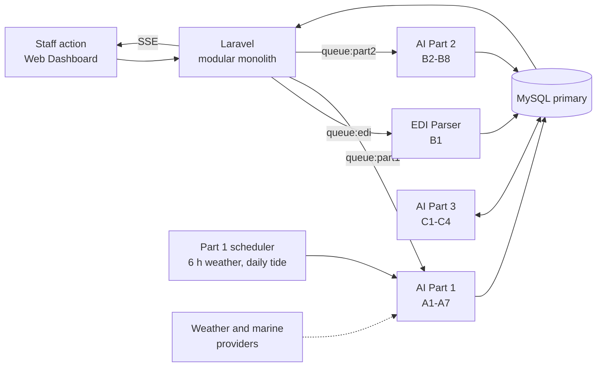

# ATLANTECH — AI Architecture (Reference for Code Agents)

> **Purpose of this file.** This is the authoritative description of the ATLANTECH AI subsystem for anyone (human or coding agent) writing code against it. Read it before touching any Python worker, any AI-related Laravel module, or any table the AI reads or writes.
>
> **Source:** AI Architecture v3 (September 2026), `Master_Context.md` §6, `ATLANTECH_System_Architecture.md` v3.0, and the AI implementation plan. Only decided architecture is described here.
>
> **Vocabulary rule:** table names, column names and status values are taken from the port database schema (`PortSync.sql`, 90 tables). Use them exactly as written here.

---

## 1. What the AI Does (One Paragraph)

ATLANTECH is a port-wide **advisory and coordination layer**. It recommends; existing terminal and port systems execute. The AI subsystem takes a berthing request that has passed Customs Approval, computes **when** the vessel can safely enter (Part 1), then computes **which shared resources** (berth, tugs, pilot) it should get and, for container vessels, **where its containers go in the yard** (Part 2). A human confirms each step. After execution, actual outcomes flow back and the AI **evaluates and improves itself locally** (Part 3). Vessel and cargo data comes from BAPLIE EDI files parsed by a deterministic parser (B1).

> **ATLANTECH recommends and coordinates. Existing terminal and port systems execute. Human approval gates every plan.**

---

## 2. Non-Negotiable Architectural Invariants

Any code that violates one of these is wrong, regardless of what else it does.

| # | Invariant |
|---|---|
| I-1 | The AI **never executes** operational decisions. Booking, plan confirmation, cancellation, dispatch, pilot/tug-master assignment, notifications, TOS entry and Customs Approval are Backend or human actions. |
| I-2 | **Part 1 never allocates resources.** It produces constraints and entry-time windows only. |
| I-3 | **Part 2 is the sole allocation authority** for berth, tug, pilot, and for yard/storage recommendations. |
| I-4 | **Part 3 learns locally.** No model, weight, training data or update ever leaves the port server (no SaaS, no other port, no federated learning). |
| I-5 | Parts 1, 2, 3 and the EDI Parser are **separate workers** with separate queues/responsibilities. Do not merge them. |
| I-6 | **Hard safety limits** (wind, wave, visibility, UKC) are fixed by the Marine Safety Officer and are **never loosened automatically** — not by the solver, not by retraining, not by bias correction. |
| I-7 | **Part 1 constraints are hard** for Part 2. The solver never relaxes them. No feasible solution → `NO_FEASIBLE_PLAN`. |
| I-8 | **FIFO fallback only on technical solver failure** (error or timeout). Infeasibility is final — never fall back to FIFO on infeasible. The FIFO plan must pass the same hard filter. |
| I-9 | **Rationale is template-based**, from fixed versioned templates. **Never an LLM.** |
| I-10 | **Tide is computed in-house** (harmonic model, pyTMD). It is not pulled from a provider. |
| I-11 | **BAPLIE parsing is deterministic** and **all-or-nothing**. It is not AI. |
| I-12 | Laravel ↔ Python is **asynchronous only**, over Redis, **one queue per worker**. Results return through **MySQL**, and Laravel pushes them to clients over the existing **SSE** channel. No other pub/sub channel, no HTTP calls between Laravel and Python. |
| I-13 | Part 3 uses **trusted data only** (`clock_skew_suspect = 0`). |
| I-14 | **No deep learning and no LLM anywhere** in the AI subsystem. ML = LightGBM only, and only where documented (M2, M3, M4). |
| I-15 | Manual environmental data entered by staff passes **the same safety constraints** — there is no bypass. |

---

## 3. Deployment Context

- Every port runs a **dedicated, identical installation** on its own server in its own LAN. Ports differ by configuration and data, never by code.
- The **Central SaaS** is a licence/registry only. It holds **no** operational data and **no** AI artefact. The only link is a daily outbound licence check-in from the port.
- The product is **port-agnostic**: all AI behaviour is driven by port data (terminals, berths, profiles, constraints, tidal constituents). It must work from **1 terminal / 5 berths** up to **10 terminals / 50 berths** with no code change.
- Reference port (case study only): **Damietta** — 8 terminals, 36 berths, ≈ 26 vessels/day.
- **Container Terminal (CT) first.** Non-Container Terminal (NCT) is master data only for now.
- Inside one port, competing terminals are separated by **terminal-level row security** (403). The AI computes port-wide; the Backend filters what each terminal user may see.

---

## 4. Runtime Topology

### 4.1 Components

```
Office users -> Web Dashboard (Vue.js) --HTTPS + SSE--\
Field crews  -> Mobile App (Flutter)   --REST + WS (via VPN)--> NGINX (TLS 1.3, LB)
                                                                  |
                                   Laravel modular monolith (Port API) + Realtime Server (Reverb)
                                                                  |
                     BAPLIE file volume          Redis: cache + queue:edi, queue:part1, queue:part2
                                                                  |
          Python workers: EDI Parser | AI Part 1 (Predictive & Env.) | AI Part 2 (AI Engine) | AI Part 3 (Feedback)
                                                                  |
                               MySQL operational DB: Primary (writes) -> Replica (reads, production)

External (outbound only): Weather & marine providers (primary + secondary) <- pulled by Part 1
```



### 4.2 Runtime chain for every AI request

```
Staff action (dashboard)
  -> Laravel (auth, RBAC, terminal scope, licence mode, validation, creates run row, audit)
  -> Redis queue (queue:part1 | queue:part2 | queue:edi)
  -> Python worker (one per part) reads port state from MySQL, computes
  -> result written directly to MySQL
  -> Laravel pushes the update to the dashboard over SSE (after commit)
```

- The user receives **202 Accepted** immediately and the result arrives later by SSE.
- **Part 1 has its own internal scheduler** for periodic environmental pulls (no Laravel call, no Laravel scheduler).
- **Part 3** runs periodically and reads/writes MySQL locally.

### 4.3 Workers and queues

| Worker | Queue | Responsibility | Nature |
|---|---|---|---|
| EDI Parser | `queue:edi` | B1 — parse BAPLIE files into vessel, containers, manifest | Deterministic |
| AI Part 1 | `queue:part1` + internal scheduler | A1–A7 — environmental data, tide, surge, feasibility, UKC, margin, demand → entry windows | Physics / rules / statistics (+ ML Phase 2) |
| AI Part 2 | `queue:part2` | B2–B7 allocation + yard placement (B8) | Rules / ML / CP-SAT optimisation / templates |
| AI Part 3 | periodic (no user queue) | C1–C4 — evaluation, drift, guarded retraining, bias correction | Statistics / MLOps |

One queue per worker guarantees that a long Part 2 solve never delays a Part 1 request someone is waiting for.

### 4.4 Technology stack (AI side)

| Item | Use |
|---|---|
| Python | All four workers |
| Google OR-Tools **CP-SAT** | Part 2 allocation solver (B5, B7) |
| **pyTMD** | Part 1 astronomical tide (A2) |
| **LightGBM** | Phase 2 models M2, M3, M4 and Part 3 retraining |
| Redis | Job queues |
| MySQL | Single source of truth; workers read state and write results directly |
| Local file volume | BAPLIE files; ML model artefacts (`ml_model_version.artifact_path`) |

---

## 5. End-to-End Flow

### 5.1 Narrative

```
Berthing Request (PRELIMINARY_APPROVED)
  -> staff record Customs Approval -> CUSTOMS_APPROVED
  -> Part 1 (queue:part1): constraints + entry-time windows
  -> HUMAN GATE 1: staff confirm one entry window -> ENTRY_WINDOW_CONFIRMED (becomes Part 2 input)
  -> Part 2 (queue:part2): ranked options for berth + tugs + pilot -> RECOMMENDATION_GENERATED
  -> HUMAN GATE 2: staff confirm the plan or override a component (reason stored) -> PLAN_CONFIRMED
  -> (container vessel) yard placement by Part 2
  -> Execution by existing systems and people -> actual outcomes
     (actual_status_update, deviation_log, recommendation_override)
  -> significant delay -> re-plan proposal (Part 2, B7)
  -> Part 3: evaluation, drift, retraining, bias correction
     -> new model version back to Part 2 / Part 1; corrected inputs back to Part 1
```

### 5.2 Request path through the AI and the two human gates

```mermaid
flowchart LR
    PA["PRELIMINARY_APPROVED"] -->|"Customs approval<br/>(staff)"| CA["CUSTOMS_APPROVED"]
    CA -->|"queue:part1"| R1["Part 1 run<br/>windows + blocked periods"]
    R1 --> G1{"Human Gate 1"}
    G1 -->|"confirm window"| EW["ENTRY_WINDOW_CONFIRMED"]
    G1 -->|"reject all / recompute"| CA
    EW -->|"queue:part2"| R2["Part 2 solve<br/>ranked options"]
    R2 -->|"NO_FEASIBLE_PLAN"| EW
    R2 --> RG["RECOMMENDATION_GENERATED"]
    RG --> G2{"Human Gate 2"}
    G2 -->|"confirm plan"| PC["PLAN_CONFIRMED"]
    G2 -->|"override / regenerate"| RG
    PC -->|"container vessel"| Y["Yard placement<br/>(Part 2)"]
    PC --> EX["Execution and<br/>actual status"]
    EX -->|"significant delay"| DR["Delay re-plan<br/>proposal"]
    DR --> PC
    EX --> P3["Part 3 evaluation"]
```



### 5.3 Berthing request lifecycle (SM-4)

Main path:
`SUBMITTED` → `PRELIMINARY_APPROVED` → `CUSTOMS_APPROVED` (entered by hand) → `ENTRY_WINDOW_CONFIRMED` (Part 1 window, staff confirm) → `RECOMMENDATION_GENERATED` (Part 2) → `PLAN_CONFIRMED` → `COMPLETED`.

Side paths:
- `NEEDS_REVISION` (back to `SUBMITTED` on resubmit), `REJECTED`, `CANCELLED` (only before preliminary approval).
- `ENTRY_WINDOW_CONFIRMED` can be **reopened** to `CUSTOMS_APPROVED` while no plan is confirmed.
- `PLAN_CONFIRMED` → `PLAN_CANCELLED` releases resources; from `PLAN_CANCELLED` the call is re-planned from `ENTRY_WINDOW_CONFIRMED` or ends.
- A **delay re-plan keeps `PLAN_CONFIRMED`** and replaces the plan version.

**Outcomes that are NOT states:** `ENV_DATA_UNAVAILABLE`, `NO_FEASIBLE_WINDOW`, `NO_FEASIBLE_PLAN`. They are stored as run outcomes; the request status does not change because of them.

Every `berthing_request` status change is written **together with its `berthing_request_status_history` row in one transaction**.

---

## 6. B1 — EDI Parser (BAPLIE Ingestion)

| Item | Detail |
|---|---|
| Worker / queue | EDI Parser, `queue:edi` |
| Standard | UN/EDIFACT **D.17A**, **SMDG 2019** BAPLIE |
| Method | Deterministic parser. Not AI. |
| Commit | **All-or-nothing**, one transaction. A crash before commit leaves nothing committed. |
| Trigger | Staff upload a BAPLIE file for a berthing request (or the Backend matches it by IMO + ETA ± 24 h). Backend stores the file on the dedicated BAPLIE volume, creates the `baplie_file` row (`STAGED`, parse `PENDING`) and enqueues the job. |
| Sequence | Read file from `storage_path` → parse → IMO check against the request's vessel → validate → commit, quarantine or fail |
| Outcomes | IMO mismatch → `QUARANTINED`; invalid content → `QUARANTINED` with `staged_payload`; unreadable → `FAILED` (no staged data); valid → `PARSED`, file becomes `ACTIVE`, earlier `ACTIVE` file becomes `REPLACED` |
| Writes on success | `vessel` (fill-empty only — never overwrite existing identity values), `container`, `container_manifest_entry`, `baplie_parse_issue`, `baplie_file` status fields |
| Performance target | 3 / 10 / 25 s by file size class |

Rules:
- **One active BAPLIE file per request.** Replacing a revision is one transaction. A mistaken upload is withdrawn (`WITHDRAWN`).
- Parse issues are stored per file (`baplie_parse_issue`) for diagnostics.
- `container` is identity; weight, stowage and ports are per call in `container_manifest_entry`.
- The Backend **blocks Customs Approval and yard recommendations while any manifest line is incomplete**.
- Status vocabularies: file `STAGED, ACTIVE, REPLACED, WITHDRAWN`; parse `PENDING, PARSED, FAILED, QUARANTINED`.

---

## 7. Part 1 — Predictive & Environmental

**Role:** produce constraints and an entry-time proposal. **Never allocates resources.**
**Trigger:** Customs Approval (`PRELIMINARY_APPROVED` → `CUSTOMS_APPROVED`), recompute, manual data submitted, or window reopened → job on `queue:part1`.
**Periodic work:** an internal Part 1 scheduler pulls environmental data with no Laravel call.

### 7.1 Components

| ID | Component | Method | Type |
|---|---|---|---|
| A1 | Data ingestion | Weather, wave and current **every 6 h**; **on-demand** weather + surge at Customs Approval; astronomical tide **daily** over a multi-day horizon; surge input follows the weather schedule; external marine data via adapter | ETL |
| A2 | Astronomical tide | Harmonic model from published constituents (**pyTMD**), computed in-house | Physics |
| A3 | Surge residual | `Surge(t) = SeaLevel(t) − Tide(t)` — a **definition**, not a prediction | Formula |
| A4 | Threshold feasibility | Wind, gust, visibility, wave, tide/surge vs. operating limits; exact, auditable rules | Rules |
| A5 | Under-keel clearance | UKC with **Barrass squat**, naval-architecture formulas | Physics |
| A6 | Uncertainty margin | Statistical margin or provider ensemble spread applied to limits | Statistics |
| A7 | Demand / peak forecast (**M3**) | Phase 1: aggregate open berthing requests + history. Phase 2: LightGBM regressor | ML (Phase 2) |

All four environmental factors (**wind, visibility, waves, tide/surge**) are always in scope, because the product is port-agnostic and tidal strength differs by port.

### 7.2 A1 — Data ingestion

- Forecast location = `port_profile` coordinates.
- Providers: **primary**, then **secondary** fallback. If both fail, the last data is kept with `data_stale = 1` and the failure is logged as an alert.
- Raw provider values are stored unchanged in `environment_forecast_point`; **unit conversion and derived values (e.g. surge) are computed on the AI side**. Provider units are recorded per run.
- Each pull is a `forecast_run` (with `pull_type` `SCHEDULED`, `ON_DEMAND` or `MANUAL`) plus its points.
- `MANUAL` forecast runs are written by the **Backend** when staff enter environmental data by hand (with `submitted_by` and unit columns); Part 1 then recomputes using them, under the same constraints.
- Outbound calls only to configured providers. No inbound endpoint exists for providers.
- **Freshness rule:** stored environmental data is usable only if measured within **48 hours** and covering the assessment horizon.

### 7.3 A2 — Astronomical tide

- Constituents are stored in `tide_constituent_set` / `tide_constituent` (entered at onboarding). Only **one active set** exists.
- Predictions are stored as `tide_prediction_run` + hourly `tide_prediction_point`.
- **Datum consistency is mandatory:** tide set `datum_reference` = `navigation_channel.depth_datum` = `berth.depth_datum`. The Backend checks this on set activation; the AI treats it as a precondition and refuses to assess on mismatch.
- On a tide computation error, previous predictions are kept.

### 7.4 A3 — Surge

`Surge(t) = SeaLevel(t) − Tide(t)`, with sea level and tide on the same datum. The Backend's conditions view computes surge on the fly with **the identical formula** — the two implementations must agree.

### 7.5 A4 — Threshold feasibility

- Limits come from `safety_constraint` + `constraint_type` (`category`, `unit`, `comparator`, `is_hard_safety_limit`, scope columns), maintained by the **Marine Safety Officer**.
- Overlapping constraints of the same type and scope are rejected by the Backend. When several scopes apply, **the strictest value wins**.
- Units follow `constraint_type.unit`.
- Each time step in the horizon is evaluated against every applicable limit; failing steps form **blocked periods** with their **limiting factor**.

### 7.6 A5 — UKC and squat

Inputs: arrival draft and block coefficient (`Cb`) from `berthing_request` (per call), LOA and beam from `vessel`, channel depth/width/`speed_limit_knots` from `navigation_channel`, berth `water_depth`, minimum UKC from `safety_constraint`.

Conceptual check per time step:

```
AvailableDepth(t) = ChartedDepth (at datum) + Tide(t) + Surge(t)
Squat             = Barrass squat (function of Cb and speed through water; standard Barrass form,
                    e.g. open water ≈ Cb · V² / 100 metres with V in knots)
UKC(t)            = AvailableDepth(t) − (Draft + Squat)
Feasible          ⇔ UKC(t) ≥ MinimumUKC (+ uncertainty margin from A6)
```

A missing required vessel/channel particular is a configuration error (run fails with a reason), never a silent pass.

### 7.7 A6 — Uncertainty margin

A statistical margin or provider ensemble spread is applied to limits to make feasibility **conservative**. The margin only ever **tightens** limits; it never loosens a hard limit.

### 7.8 A7 — Demand / peak congestion (M3)

- Phase 1: aggregation of open berthing requests (plus history) into time slots → `demand_forecast_slot` with `method = AGGREGATION`; produces `peak_congestion_score`. Empty → score 0.
- Phase 2: LightGBM regressor (target: arrivals per slot), activated only when it beats the aggregation baseline (see §10).

### 7.9 Part 1 run sequence

```
Claim run (QUEUED -> RUNNING, conditional update)
 -> eligibility check (request must still be CUSTOMS_APPROVED, else discard)
 -> obtain environmental data (on-demand pull, or stored data <= 48 h covering the horizon, or MANUAL run)
 -> tide for missing hours
 -> surge
 -> A4 thresholds + A5 UKC/squat, with A6 margin
 -> A7 peak congestion
 -> persist outcome; run DONE; earlier run REPLACED
```

Outcomes (`part1_run.outcome`):

| Outcome | Meaning |
|---|---|
| `WINDOWS_FOUND` | At least one feasible window |
| `NO_FEASIBLE_WINDOW` | No feasible step in the horizon; limiting factors reported |
| `ENV_DATA_UNAVAILABLE` | No usable environmental data; staff may enter data manually |

Technical failure → retry **up to 3 times** (`retry_count`) → `FAILED`; staff may recompute.

### 7.10 Part 1 output

| Field | Stored in |
|---|---|
| `feasible_windows` (start, end, confidence) | `feasible_window` |
| `blocked_periods` (start, end, limiting_factor) | `blocked_period` |
| `peak_congestion_score` | `entry_window_proposal` |
| `data_versions` (weather run, tide run, bias-correction version) | `entry_window_proposal.forecast_run_id`, `tide_prediction_run_id`, `bias_correction_version_id` |

The proposal is created with status `PROPOSED`. Proposal statuses: `PROPOSED, CONFIRMED, REPLACED, REJECTED`.

### 7.11 Human Gate 1 (Backend-owned)

Port Authority Staff review and:
- **Confirm one window** → server re-checks the window belongs to the latest result and still passes → request `ENTRY_WINDOW_CONFIRMED` → Part 2 job enqueued. (409 if not latest or no longer valid.)
- **Reject all** → proposal `REJECTED` (allowed in `READ_ONLY`).
- **Recompute** → new Part 1 run.
- **Reopen** (no confirmed plan) → back to `CUSTOMS_APPROVED` + new run.

The confirmed window becomes a **hard input** to Part 2.

---

## 8. Part 2 — AI Engine

**Role:** the **sole authority** for shared-resource allocation (berth, tug, pilot) and for yard/storage recommendations.
**Queue:** `queue:part2`.

### 8.1 Triggers (`solver_run.trigger_type`)

| Trigger | When | Notes |
|---|---|---|
| `NEW_REQUEST` | Request reaches `ENTRY_WINDOW_CONFIRMED`, or a cancelled plan whose call continues returns there | Initial recommendation, `recommendation.purpose = INITIAL` |
| `MANUAL` | Staff regenerate **before** confirmation (409 after) | Previous version stays current if regeneration fails |
| `RESOURCE_CHANGE` | A berth, tug or pilot changes state (including resources released by a cancellation) | Only pending recommendations that use that resource are regenerated |
| `REPLAN` | Backend detects a **significant deviation** on a confirmed plan (Port Admin thresholds per operation type) | Rolling-horizon re-solve, `purpose = DELAY_REPLAN` |

In `READ_ONLY` licence mode no new plan is created or regenerated (423); the previous version stays current.

### 8.2 Inputs

- Confirmed entry window + Part 1 constraints (hard).
- BAPLIE-derived vessel and cargo data.
- **Live (actual)** berth, tug and pilot state. Occupancy = `plan_component` rows with `reservation_state = RESERVED` overlapping the window.
- Competing requests and already-confirmed plans.
- Marine Safety Officer constraints (`safety_constraint`).
- Master data: `terminal`, `berth`, `berth_terminal` (which terminals may use each berth), `tugboat`, `pilot_profile`, `pilot_rank_limit`, `pilot_schedule`, `port_shift`, `tug_master_profile`, `tug_master_schedule`, `terminal_productivity_profile`.

### 8.3 Components

| ID | Component | Method | Type |
|---|---|---|---|
| B1 | BAPLIE parser | See §6 (separate EDI Parser worker) | Deterministic |
| B2 | Constraint filter | LOA, draft, terminal type, Marine Safety Officer constraints, Part 1 windows | Rules |
| B3 | Service time (**M2**) | Phase 1: `ServiceTime = Moves / ProductivityRate + FixedOverhead`. Phase 2: LightGBM quantile regression **P50 / P90** | ML (Phase 2) |
| B4 | Delay risk (**M4**) | Rule-based score until enough data; then LightGBM classifier on deviation & override history | ML |
| B5 | CP-SAT solver | OR-Tools, Berth Allocation Problem with tugs and pilots, **port-wide joint solve**, guaranteed feasible | Optimisation |
| B6 | Rationale | Fixed, versioned templates tied to binding constraints and objective terms; **never an LLM** | Template |
| B7 | Re-planning | Re-solve on a rolling horizon with updated inputs | Optimisation |
| B8 | Yard placement (CT) | Block-level container placement after plan confirmation | Rules / optimisation |

### 8.4 Solve pipeline

```
Load live state
 -> B2 hard constraint filter (candidate berths per request)
 -> B3 service time per request × candidate berth
 -> B4 delay risk
 -> tug requirement per request (number of tugs comes from the AI formula)
 -> B5 CP-SAT joint solve (time limit 10 s)
 -> hard filter again on every emitted option
 -> rank options
 -> B6 rationale
 -> persist results
```

### 8.5 B2 — Constraint filter

Eliminates any request–berth pairing that violates: vessel LOA vs `berth.max_vessel_loa`, draft vs berth depth, terminal type / `berth_terminal` compatibility, Marine Safety Officer constraints, and the confirmed Part 1 window. Missing master data → no candidate → `NO_FEASIBLE_PLAN` with the binding reason.

### 8.6 B3 — Service time (M2)

- Phase 1 formula uses `terminal_productivity_profile` (`productivity_rate`, `rate_unit`, `fixed_overhead_minutes`), resolved by date and vessel type, and the number of moves from the manifest.
- Output stored as `service_time_p50_hours` and `service_time_p90_hours` (hours).
- No valid productivity profile → option cannot be timed → candidate excluded with reason.

### 8.7 B4 — Delay risk (M4)

- Value in 0–1 (`delay_risk`). Phase 1 rule-based score (or NULL when no rule applies).
- Phase 2 LightGBM classifier trained on trusted deviation and override history.

### 8.8 B5 — CP-SAT model

- **Decision structure:** interval variables per request × candidate berth; `NoOverlap` per berth; no-overlap / cumulative per tug and per pilot; start within the confirmed window; **fixed intervals** for confirmed plans and for components already `STARTED`.
- **Joint solve:** overlapping requests are evaluated **together** against the current port state — never one vessel in isolation when shared resources are involved. Competing vessels for the same pilot or tug in an overlapping window are resolved by the joint solve under the objective terms (`objective_term`).
- **Ranking:** by **time urgency**, then by **financial impact** when time priority is close or tied.
- **Why a solver (not ML):** it guarantees a feasible solution when one exists and solves fast at reference scale without the data volume a learned allocator needs. ML is only used for service time, delay risk and demand.
- **Time budget:** solve ≤ **10 s**, total pipeline ≤ **12 s**.

### 8.9 Solver outcomes

| Outcome | `solver_run.status` | Behaviour |
|---|---|---|
| Solved | `OPTIMAL` / `FEASIBLE` | Ranked options, `recommendation.source = AI` |
| Technical failure (error / timeout) | `ERROR` | **FIFO plan by arrival order** that passes the same hard filter, `source = FIFO`, reason in `result_detail`; shown to staff as fallback / sub-optimal |
| Infeasible | `INFEASIBLE` | Final **`NO_FEASIBLE_PLAN`** with binding constraints. **No FIFO plan.** Request stays `ENTRY_WINDOW_CONFIRMED`; staff can regenerate later |

### 8.10 Part 2 output — ranked options

Each `recommendation_option`:

| Field | Meaning |
|---|---|
| `rank` | 1 = best |
| `berth_id` | Proposed berth |
| start, end | Proposed berth interval (UTC) |
| tugs | `recommendation_option_tug` rows (one per tug) |
| `pilot_id` | Proposed pilot |
| `service_time_p50_hours`, `service_time_p90_hours` | B3 |
| `delay_risk` | B4 (0–1) |
| `rationale_text` | B6 rendered template |
| `objective_score` | Solver score |

Also written: `solver_run` (status, `objective_value`, `solve_time_ms`, `solver_version`, `result_detail`), `recommendation` (status `PENDING_REVIEW`, `source`, `purpose`, `entry_window_proposal_id`), `recommendation_rationale_factor` (factors that drove the solve), `solver_run_model_version` (which model versions were used).

Recommendation statuses: `PENDING_REVIEW, MODIFIED_BY_STAFF, CONFIRMED, REJECTED, INVALIDATED, REPLACED`. On regeneration the new version is `PENDING_REVIEW` and the previous one `REPLACED`.

### 8.11 B6 — Rationale

- Fixed, versioned templates in `rationale_template`; selected and filled from the **binding constraints** and **objective terms** of the solve.
- Never generated by an LLM.
- Must not leak another terminal's confidential data (cargo, stowage, yard, costs) into rationale text.

### 8.12 Human Gate 2 (Backend-owned)

Port Authority Staff:
- **Review** (recorded in `recommendation_review`).
- **Override** a component (berth, pilot, tug, start time) with a **reason** stored in `recommendation_override`. The new value is validated against availability and **hard constraints** — a violation is refused (422) with the violated constraint; a valid override creates a `MODIFIED_BY_STAFF` version. Validation fails closed.
- **Confirm** → one Backend transaction: re-check, book (`plan_component` rows `RESERVED`), `operational_plan` `CONFIRMED` referencing the selected `recommendation_option`, version `CONFIRMED`, request `PLAN_CONFIRMED`. Conflict → rollback + 409.

Overrides are a **signal for Part 3**, never a silent retraining trigger.

### 8.13 B7 — Delay re-plan

- Trigger: significant deviation on a `CONFIRMED` plan (not in `READ_ONLY`; there staff are notified instead).
- Rolling-horizon re-solve with **`STARTED` components fixed** → proposal version with `purpose = DELAY_REPLAN`.
- On staff confirmation (Backend transaction): reserve new, release unused, keep `STARTED`, old version `REPLACED`, proposal becomes the current `INITIAL` version. Failure → rollback; old version stays confirmed.
- The request stays `PLAN_CONFIRMED` throughout.

### 8.14 B8 — Yard placement (Container Terminal)

| Item | Detail |
|---|---|
| Trigger | Plan confirmed for a container vessel with an `ACTIVE` BAPLIE (automatic), or the CT Operation Planner requests again. Backend creates `terminal_recommendation` with `YARD_REC_REQUESTED` and enqueues on `queue:part2` |
| Inputs | Manifest (`container_manifest_entry`), yard structure (`yard_zone`, `yard_block`, `yard_slot`, `reefer_zone_detail`, `dg_zone_allowed_class`, `oog_zone_detail`), equipment, plan schedule |
| Hard rules | Reefer, dangerous goods (IMDG class), out-of-gauge, capacity, blocked slots (a blocked slot holds no container). Capacity/occupancy derived from `yard_slot` |
| Output | `YARD_REC_GENERATED` with `yard_placement_item` rows (block required, slot optional), `rationale_template_id`, `confidence`; or `GENERATION_FAILED` with `failure_reason` |
| Never | The worker **never changes `yard_slot.container_id`** and never reserves capacity |
| Gate | Planner accepts (decision only, reserves nothing), adjusts (each adjustment re-validated) or rejects (allowed in `READ_ONLY`). Hand-off to the TOS is manual; `EXPORTED_TO_TOS` is recorded |
| Visibility | `terminal_recommendation` is visible **to its own terminal only** |

`terminal_recommendation` is the common output contract for terminal-level recommendations.

---

## 9. Part 3 — Feedback Loop (local to the port)

**Role:** evaluate the AI against reality and improve it, **on this server only**.
**Runs:** periodically.

### 9.1 Components

| ID | Component | Method | Writes |
|---|---|---|---|
| C1 | Outcome evaluation | MAE, override rate, wait time, Part 1 window accuracy (forecast vs actual) | `evaluation_metric` |
| C2 | Drift monitor | **PSI** + rolling **MAE** on M2, M3, M4 | `drift_measurement`; above threshold → `DRIFT_ALERT` notification (sent by Backend) |
| C3 | Retraining pipeline | Time-based split; **Champion vs Challenger**; guarded automatic | `ml_model_version`, `retraining_run` |
| C4 | Forecast bias correction | Regression or quantile mapping on the forecast-vs-actual gap | New bias-correction version; corrected **inputs** go to Part 1 (raw data is never modified) |

### 9.2 Inputs

- `actual_status_update` (with `reported_at`, `client_sent_at`, server receipt time, `clock_skew_suspect`, `sync_source`).
- `deviation_log` (types `DELAY`, `RESOURCE_CHANGED`, `STATE_MISMATCH`).
- `recommendation_override` (with reasons).
- Waiting times; forecast vs actual environmental data.
- **Only trusted rows:** `clock_skew_suspect = 0`. Rows with `1` are excluded from evaluation and training.

### 9.3 Guarded automatic retraining (C3)

```
Periodic retraining, no human approval step
 -> not enough trusted data -> skip; Champion stays
 -> train Challenger on time-based split
 -> compare on held-out, time-based data: MAE and override rate
     -> Challenger NOT worse on both -> PROMOTED (new Champion, deployment time recorded)
     -> otherwise -> KEPT_CHAMPION, flag logged for review (review_pending; RETRAINING_REVIEW_NEEDED)
 -> training failure -> FAILED, Champion unchanged
 -> previous Champion always kept for rollback
```

- Exactly **one CHAMPION per model**.
- Overrides are analysed as a signal; they never silently trigger retraining.
- **Hard safety limits never change automatically.**
- `retraining_run.decision`: `PROMOTED`, `KEPT_CHAMPION`, `FAILED`. Port Admin review fields: `reviewed_by`, `reviewed_at`, `review_note`.

### 9.4 Model registry

`ml_model` keys:

| Key | Component |
|---|---|
| `M2_SERVICE_TIME` | B3 |
| `M3_DEMAND_FORECAST` | A7 |
| `M4_DELAY_RISK` | B4 |
| `FORECAST_BIAS_CORRECTION` | C4 |

`ml_model_version.artifact_path` points to the **local file volume only**.

### 9.5 MVP scope

In the MVP, Part 3 delivers **C1 evaluation and C2 drift monitoring**. C3 retraining and C4 bias correction are **data-gated**: ≈ 26 vessels/day ≈ 9,500 calls/year, estimated enough for LightGBM after several months of real operation. Until then the formula and rule paths run, and the system is fully functional without ML.

---

## 10. ML Strategy (Phase 1 → Phase 2)

| Model | Problem | Phase 1 (runs now) | Phase 2 (data-gated) | Target / label | Guard metrics |
|---|---|---|---|---|---|
| M2 | Service time | `Moves / ProductivityRate + FixedOverhead` | LightGBM quantile regression P50 / P90 | Actual berth occupation time (berth component start → completion, trusted rows) | MAE (+ quantile coverage) |
| M3 | Demand / peak | Aggregation of open requests + history | LightGBM regressor | Arrivals per slot | MAE |
| M4 | Delay risk | Rule-based score | LightGBM classifier | Significant `DELAY` deviation on a plan component | Classification metrics + promotion guards |

Rules:
- A Phase 2 model replaces its Phase 1 path **only if it beats the Phase 1 baseline** on time-based held-out data, and only through C3's guarded promotion.
- Validation is always a **time-based split** (no random splits; avoid leakage from post-arrival features).
- No deep learning, no LLM.

Non-ML methods (by design, not by lack of data): harmonic tide, surge definition, threshold rules, Barrass/UKC, CP-SAT, FIFO, templates, PSI/MAE.

**Build vs buy:** build in-house what depends on private operational data (M2–M4, BAPLIE parsing, CP-SAT model) and tide; consume externally only raw weather and sea-level data (primary + secondary provider).

---

## 11. Responsibility Boundary: AI Workers vs Backend

| Concern | Owner |
|---|---|
| Authentication, RBAC, terminal scope, licence mode (401/403/423), write chain, audit of user actions | Backend |
| Creating `part1_run` (QUEUED), `terminal_recommendation` (`YARD_REC_REQUESTED`), `baplie_file` (STAGED/PENDING) before enqueuing | Backend |
| Enqueuing jobs on `queue:part1`, `queue:part2`, `queue:edi` | Backend |
| Periodic environmental pulls | Part 1 scheduler |
| Computing AI results and writing result tables | AI workers |
| Manual environmental data form, validation, storage as `forecast_run` with `pull_type = MANUAL` | Backend |
| Human Gate 1 and 2 actions (confirm, reject, reopen, override, regenerate) | Backend |
| Plan confirmation, booking, cancellation, dispatch | Backend |
| SSE / WebSocket notifications (after commit) and `notification_log` | Backend (Realtime Server) |
| Execution data ingestion, deviation detection and significance, `clock_skew_suspect` | Backend |
| Deciding a deviation is significant and triggering `REPLAN` | Backend |
| Terminal-level filtering of AI outputs for terminal users | Backend |
| Schema migrations (including AI-written tables) | Backend (single migration owner) |

Notification types created for AI outcomes: `ENTRY_WINDOW_READY`, `RECOMMENDATION_READY`, `YARD_RECOMMENDATION_READY`, `YARD_RECOMMENDATION_FAILED`, `DRIFT_ALERT`, `RETRAINING_REVIEW_NEEDED`.

### 11.1 Licence mode effects

| Mode | Effect on AI |
|---|---|
| `SETUP` | Onboarding only; no operational AI work |
| `FULL` | All AI flows allowed |
| `READ_ONLY` | No new runs/plans/regenerations from user actions (423). Allowed: reject-all on windows, reject on yard recommendations; running work can still be updated. Delay re-plan: staff notified, no proposal. Yard request: reason recorded, planner notified |

---

## 12. Data Model Map for the AI

### 12.1 Tables the AI reads

| Domain | Tables |
|---|---|
| Configuration | `port_profile` (lat/lon, `timezone`), `port_setting`, `navigation_channel` (depth, width, `speed_limit_knots`, `depth_datum`), `channel_waypoint`, `license_state` |
| Resources | `terminal`, `berth` (`max_vessel_loa`, `water_depth`, `depth_datum`), `berth_terminal`, `tugboat` (`status`, `tug_power`, `tug_power_unit`), `pilot_profile`, `pilot_rank_limit`, `pilot_schedule`, `port_shift`, `tug_master_profile`, `tug_master_schedule` |
| Vessel and request | `vessel` (`imo_number`, `loa`, `beam`, `max_draft`), `vessel_type`, `berthing_request` (`requested_eta`, `arrival_draft`, `block_coefficient`, `gross_tonnage`, `deadweight_tonnes`, `status`), `berthing_request_cargo`, `berthing_request_status_history` |
| Safety and productivity | `constraint_type`, `safety_constraint`, `terminal_productivity_profile` |
| Yard and equipment | `storage_facility`, `yard_zone`, `yard_zone_type`, `yard_block`, `yard_slot`, `reefer_zone_detail`, `dg_zone_allowed_class`, `oog_zone_detail`, `equipment`, `equipment_capability`, `container_size_type`, `imdg_class` |
| Plan and execution | `operational_plan`, `plan_component` (`reservation_state`, `planned_start/end`), `recommendation_override`, `actual_status_update`, `deviation_log`, `status_type` |
| Tide master data | `tide_constituent_set` (`datum_reference`, `is_active`), `tide_constituent` |
| Seeds | `objective_term`, `rationale_template`, `ml_model` |

### 12.2 Tables the AI writes

| Table(s) | Writer | Notes |
|---|---|---|
| `forecast_run`, `environment_forecast_point` | Part 1 (`SCHEDULED`, `ON_DEMAND`); Backend for `MANUAL` | Raw provider values |
| `tide_prediction_run`, `tide_prediction_point` | Part 1 | Hourly |
| `demand_forecast_slot` | Part 1 | `method = AGGREGATION` until M3 promoted |
| `part1_run` | Backend creates; Part 1 updates status, outcome, retries, proposal link | |
| `entry_window_proposal`, `feasible_window`, `blocked_period` | Part 1 creates (`PROPOSED`), marks `REPLACED` on recompute | Backend writes `CONFIRMED` / `REJECTED` |
| `solver_run`, `solver_run_model_version` | Part 2 | |
| `recommendation`, `recommendation_option`, `recommendation_option_tug`, `recommendation_rationale_factor` | Part 2 | Backend sets `CONFIRMED`, `MODIFIED_BY_STAFF`, `REPLACED` on delay re-plan confirmation |
| `terminal_recommendation`, `yard_placement_item` | Backend creates the request row; Part 2 writes the generation result | Backend writes decisions and export fields |
| `baplie_file` (status fields), `baplie_parse_issue`, `container`, `container_manifest_entry`, `vessel` (fill-empty) | EDI Parser | Backend creates the file row |
| `evaluation_metric`, `drift_measurement` | Part 3 | |
| `ml_model_version`, `retraining_run` | Part 3 (data-gated) | Backend writes review fields |

**No AI table, model or record belongs in the Central SaaS database.**

### 12.3 How results link to the request

`part1_run.berthing_request_id`; `entry_window_proposal.berthing_request_id`; `recommendation.berthing_request_id` + `entry_window_proposal_id` (composite FK guarantees the same request); `operational_plan.recommendation_option_id`; `terminal_recommendation.recommendation_id`; `baplie_file.berthing_request_id`.

### 12.4 Key modelling facts

- `vessel` = identity; Cb, GT, DWT and drafts are **per call** on `berthing_request`.
- `plan_component`: one row per dispatched unit (one per tug); component types `BERTH`, `PILOT`, `TUG`, `TERMINAL_OPS`; `reservation_state` `RESERVED` / `RELEASED` / `CONSUMED`. Occupancy is derived from `RESERVED` rows overlapping a window.
- A new field status is an `INSERT` into `status_type`, not an `ALTER`.
- `audit_log` is append-only (application user has `INSERT` and `SELECT` only). `audit_log.actor_id` NULL = system / AI worker.
- Operational plan statuses: `CONFIRMED, CANCELLED, COMPLETED`.

---

## 13. Cross-Cutting Engineering Rules

### 13.1 Time and units
- All database datetimes are **UTC**. Port local time lives in `port_profile.timezone`; shifts (`port_shift`) are in local time. Convert in one place.
- Durations in **hours** where the schema says hours (`service_time_*_hours`).
- Provider units are recorded per run; conversions happen on the AI side.
- Tide, sea level, channel depth and berth depth must share **one datum**.

### 13.2 Run handling
- The run row is the **correlation id**; every log line of a job carries it.
- Workers claim a run with a conditional update `QUEUED → RUNNING`; a duplicate delivery that finds `RUNNING`/`DONE` exits without re-executing.
- A Part 1 run whose request is no longer `CUSTOMS_APPROVED` is discarded.
- A new successful run marks the previous result `REPLACED`; a failed regeneration leaves the previous result current.

### 13.3 Traceability and versions
Every result must be traceable to the code, solver, data and model versions that produced it:
- `solver_run.solver_version`, `solver_run_model_version`
- `entry_window_proposal.forecast_run_id`, `tide_prediction_run_id`, `bias_correction_version_id`
- `rationale_template.version`
- `ml_model_version` (training window, row count, metrics)

### 13.4 Security
- Secrets (provider API keys, DB credentials) live in environment configuration, never in code.
- Workers make outbound calls only to the configured weather/marine providers.
- TLS 1.3 at NGINX; AES-256 at rest.
- No model or data leaves the server.

### 13.5 Performance and reliability targets
| Target | Value |
|---|---|
| Solver time limit / total Part 2 pipeline | 10 s / ≤ 12 s |
| End-to-end recommendation latency at 15 concurrent pipelines | p50 ≤ 3 s, p95 ≤ 8 s, p99 ≤ 15 s |
| Parallel solves | ≥ 5 |
| BAPLIE parse by size class | 3 / 10 / 25 s |
| SSE after commit | ≤ 5 s |
| Worker restart | ≤ 60 s; availability ≥ 99 % in evaluation |

---

## 14. Quick Reference: Component Index

| ID | Part | Name | Type | Output |
|---|---|---|---|---|
| B1 | EDI | BAPLIE parser | Deterministic | vessel, containers, manifest |
| A1 | 1 | Data ingestion | ETL | `forecast_run`, `environment_forecast_point` |
| A2 | 1 | Astronomical tide | Physics (pyTMD) | `tide_prediction_*` |
| A3 | 1 | Surge residual | Formula | surge series |
| A4 | 1 | Threshold feasibility | Rules | blocked steps + limiting factor |
| A5 | 1 | UKC + Barrass squat | Physics | depth feasibility |
| A6 | 1 | Uncertainty margin | Statistics | tightened limits |
| A7 | 1 | Demand / peak (M3) | Aggregation → LightGBM | `demand_forecast_slot`, `peak_congestion_score` |
| B2 | 2 | Constraint filter | Rules | candidate pairings |
| B3 | 2 | Service time (M2) | Formula → LightGBM quantile | P50 / P90 hours |
| B4 | 2 | Delay risk (M4) | Rule → LightGBM classifier | `delay_risk` 0–1 |
| B5 | 2 | CP-SAT solver | Optimisation | ranked feasible options |
| B6 | 2 | Rationale | Templates | `rationale_text` |
| B7 | 2 | Re-planning | Optimisation | `DELAY_REPLAN` version |
| B8 | 2 | Yard placement | Rules / optimisation | `yard_placement_item` |
| C1 | 3 | Outcome evaluation | Statistics | `evaluation_metric` |
| C2 | 3 | Drift monitor | PSI + rolling MAE | `drift_measurement` |
| C3 | 3 | Retraining | Champion / Challenger | `ml_model_version`, `retraining_run` |
| C4 | 3 | Bias correction | Regression / quantile mapping | corrected Part 1 inputs |

---

## 15. Out of Scope (do not build)

- Vision module.
- Any cross-port or port↔SaaS sharing of data or models (federated learning rejected).
- Vessel-to-terminal assignment (fixed by commercial contracts).
- Customs systems integration (Customs Approval is recorded by hand).
- AIS / telemetry, direct equipment control, mooring and bunkering execution.
- External berthing-request sources and live TOS integration (requests are entered by staff; yard plans reach the TOS by manual hand-off).
- Any LLM or deep-learning component.
