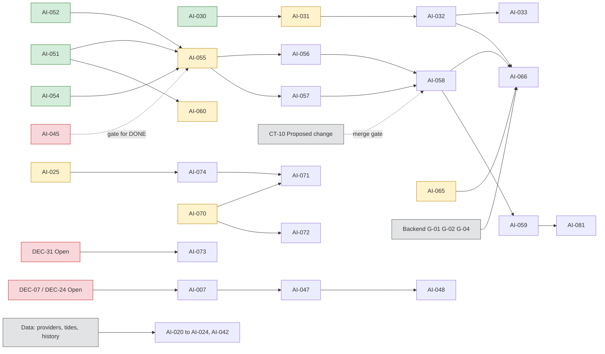

# Autonomous execution plan and checkpoint

Setup record (not in the backlog), written for whoever resumes the AI-track work, human or AI session. The backlog (`ATLANTECH_AI_TASKS.md`) stays the official task list and `WORK_STATUS.md` the tracker; this file holds the execution order, the dependency picture and the resume point. Related: [INTEGRATION_TASKS.md](INTEGRATION_TASKS.md) · [BLOCKED_TASKS.md](BLOCKED_TASKS.md) · [DECISION_RECOMMENDATIONS.md](DECISION_RECOMMENDATIONS.md).

## 0a. Checkpoint 3 (2026-11-21, round 3)

See `reports/AUTONOMOUS_EXECUTION_FINAL.md` § Round 3: the PR queue (six task branches, SETUP last), the new AI-060 handler branch (`4add5e0`), the AI-057 finding (no templates, INT-Q4) and the exact next action. Decision review R6–R8: `DECISION_RECOMMENDATIONS.md`.

## 0. Checkpoint 2 (2026-11-21, after the first merge round)

**Verified on GitHub:** PRs #41 to #47 merged into `develop` on 2026-11-21 (SETUP `6ed8c91`, AI-070 `78c1590`, AI-025 `1a996e0`, AI-092 `fec76df`, AI-031 `4408065`, AI-055 `c7e60f1`, AI-060 `8b955ed`); CI (`ci-ok`: lint, typecheck, tests with MySQL and Redis, secret scan) green on every merge commit. `develop` = `8b955ed`: 1634 unit tests pass locally (1433 + 201). **AI-065 was not merged** (no PR was opened); its branch now has `develop` merged in and conflicts resolved (head `62f3af0`, CI green). The merge round re-added the stale AI-051 tracker row; this branch removes it.

**PortHub:** `38dd6b5` and `a3a1eb3` are on `main`; pointer moved again in `e06e102` (`project-ai` → `8b955ed`). Shared Decisions still identical up to "AI task decisions"; Contracts unchanged.

**Task states after verification:** DONE: AI-025, AI-031, AI-092, SETUP-autonomous-execution-records. BLOCKED after merge: AI-055 (AI-045 gate), AI-070 (registration, DEC-08 grants). IN PROGRESS: AI-060 (queue handler).

**Second round, pushed and awaiting PR + merge:**

| Task | Branch | Head | Note |
|---|---|---|---|
| AI-065 | `feature/AI-065-yard-placement-design` | `62f3af0` | Carried over; `develop` merged in |
| AI-056 | `feature/AI-056-solver-outcome-handling` | `ac3f51a` | 19 tests, CI green |
| AI-074 | `feature/AI-074-trusted-data-selection` | `57b3817` | 8 unit + 1 integration test |
| SETUP | `feature/SETUP-post-merge-records` | see branch | These records. **Merge it last** |
| AI-032 | `feature/AI-032-baplie-commit-quarantine` | `6ae3ce7` | 35 unit + 2 MySQL tests (fault injection); full suite with services passes locally |
| AI-072 | `feature/AI-072-drift-monitor` | `f3483fb` | 15 unit + 1 MySQL test; thresholds DEFERRED (DEC-30 TR-01/02) |

**Placement rule (fewer conflicts):** new task-decision entries and tracker rows are inserted right after their predecessor's (AI-056 after AI-055, AI-074 after AI-025), not at the end. AI-065, AI-056 and AI-074 touch different places and merge in any order. The SETUP branch edits the rows next to those inserts, so merge it last; its conflicts are resolved on the branch by merging `develop` into it.

**Merge check:** `git merge-tree` shows AI-065, AI-056, AI-074, AI-032 and AI-072 merge cleanly with each other; only this SETUP branch conflicts (tracker rows).

**Still ready after that, not started:** the shared DB loader for B2's `FilterContext` (unblocks the AI-060 handler and AI-058); AI-057's engine, without real templates (AI-009).

**Exact next action:** open PRs for the branches above (SETUP last), then recompute: AI-058 needs AI-056, AI-057 and the CT-10 approval; AI-033 and AI-066 need AI-032; AI-071 needs AI-074.

## 1. Checkpoint 1 (2026-11-21, history)

| Item | State |
|---|---|
| Authorization | The user's standing execution authorization of 2026-11-21 (plan approval and `APPLY CHANGES` for eligible tasks; no protected-branch pushes, no local merges) |
| `origin/develop` | `3180e90` (PR #40). Every branch below starts there |
| PortHub `origin/main` | `a3a1eb3`: `38dd6b5` synced DEC-34 Closed and the AI-051 CT-10 Proposed row; `a3a1eb3` points `project-ai` at `3180e90`. Decisions identical up to "AI task decisions" |
| Tools | `gh` not installed: no PR can be opened or merged from this machine. `git push` works. Docker daemon down: integration tests run only in CI |
| Baseline tests at `3180e90` | 1433 passed, 47 skipped, 454 integration deselected; ruff, format, mypy clean |
| Pre-session work | Backed up with hashes in `C:\Users\Dev-Mustafa\ATLANTECH\_backups\2026-11-21-preflight\`; the AI-065 record moved onto its fast-forwarded branch |

**Pushed, awaiting PR and merge** (no task here is `DONE` until its PR is merged):

| Task | Branch | Head | Tests added | Note |
|---|---|---|---|---|
| AI-065 | `feature/AI-065-yard-placement-design` | `5884fad` | — (decision task) | B8 constraint-to-table mapping |
| AI-055 | `feature/AI-055-b5-cp-sat-allocation-model` | `86ea7d6` | 51 | Adds `ortools`. Not `DONE` before AI-045 |
| AI-031 | `feature/AI-031-baplie-validation-rules` | `23d0148` | 70 (+1 skip) | Corpus case 12 skipped (no stowage bounds) |
| AI-060 | `feature/AI-060-override-validation-service` | `4b12897` | 27 | Queue handler wiring is a follow-up |
| AI-025 | `feature/AI-025-data-quality-checks` | `6488341` | 21 | |
| AI-070 | `feature/AI-070-model-registry-integration` | `36fdd09` | 16 (+2 integration) | Registration blocked by DEC-08 grants |
| AI-092 | `feature/AI-092-observability-logs-metrics` | `71ce70c` | 16 | Touches `common/runtime/worker.py` |
| SETUP | `feature/SETUP-autonomous-execution-records` | this branch | — | These records; DEC-34 and AI-051 marked `DONE` |

**Merge note.** Every task branch appends one entry to the end of `docs/ref/ATLANTECH_Decisions.md` and one row to the end of `docs/tasks/WORK_STATUS.md`. After the first merge, each later PR shows a conflict there; resolve by keeping both sides. Suggested order (fewest code overlaps first): AI-065 → AI-025 → AI-031 → AI-070 → AI-092 → AI-055 → AI-060 → SETUP. After each merge, move the PortHub `project-ai` pointer to the new `develop` head.

**Exact next action.** Open the eight PRs into `develop` (links in `reports/AUTONOMOUS_EXECUTION_FINAL.md` §11), get CI green and merge. Then recompute the ready set: AI-032 (after AI-031), AI-056 and AI-057 (after AI-055), AI-074 (after AI-025), AI-071 and AI-072 (after AI-070 and their other prerequisites).

## 2. Task inventory (state on 2026-11-21)

| State | Tasks |
|---|---|
| DONE (merged into `develop`) | AI-001 to AI-006, AI-008 to AI-016, AI-023, AI-030, AI-044, AI-050 to AI-054; DEC-20, DEC-21, DEC-34; SETUP-001 to SETUP-003 |
| AWAITING MERGE (this session) | AI-025, AI-031, AI-055, AI-060, AI-065, AI-070, AI-092 |
| NEEDS USER DECISION (AI Team owns it) | AI-073 (DEC-31), AI-007 (DEC-07, DEC-24), AI-045 path (synthetic data, see recommendations) |
| BLOCKED_INTERNAL (waits for a merge) | AI-032, AI-056, AI-057, AI-074, AI-071, AI-072, AI-058 and everything after them |
| BLOCKED_EXTERNAL (data or another team) | AI-020, AI-021, AI-022, AI-024, AI-042, AI-100 to AI-106 (flag D); AI-066 also needs Backend G-01/G-02/G-04 |
| NOT STARTED, later waves | AI-033, AI-040, AI-041, AI-043, AI-046 to AI-049, AI-059, AI-061, AI-062, AI-067, AI-068, AI-080 to AI-084, AI-090, AI-091, AI-093 to AI-095 |

Details per blocked task: [BLOCKED_TASKS.md](BLOCKED_TASKS.md).

## 3. Dependency picture (open work)

**Critical path now:** merge AI-055 → AI-056 / AI-057 → AI-058 (also needs the CT-10 approval) → AI-059 → AI-081 → AI-090. AI-045 (needs a decision on synthetic data, or AI-043 first) gates marking AI-055 `DONE` and any Part 2 demo.

**Independent streams after the merges:** EDI (AI-032, AI-033) · Part 2 outcomes (AI-056, AI-057) · Part 3 (AI-074, then AI-071, AI-072) · Part 1 (after DEC-07 / DEC-24 and the data tasks).

## 4. How to resume

1. Read this checkpoint, then `git fetch` and check which of the branches in §1 are merged (`git branch -r --merged origin/develop`).
2. For each merged task, set its `WORK_STATUS.md` row and status record to `DONE` and move the PortHub pointer.
3. Recompute the ready set with the backlog's §3.2 table and §2 here; start each new task from the fresh `origin/develop`.
4. Check [DECISION_RECOMMENDATIONS.md](DECISION_RECOMMENDATIONS.md) for answers the user has given since.
