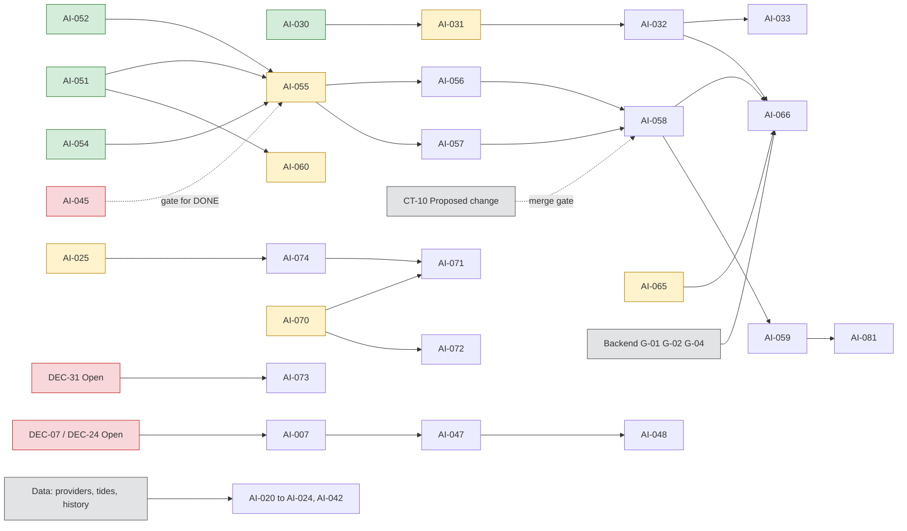

# Autonomous execution plan and checkpoint

Setup record (not in the backlog), written for whoever resumes the AI-track work, human or AI session. The backlog (`ATLANTECH_AI_TASKS.md`) stays the official task list and `WORK_STATUS.md` the tracker; this file holds the execution order, the dependency picture and the resume point. Related: [INTEGRATION_TASKS.md](INTEGRATION_TASKS.md) · [BLOCKED_TASKS.md](BLOCKED_TASKS.md) · [DECISION_RECOMMENDATIONS.md](DECISION_RECOMMENDATIONS.md).

## 0l. Checkpoint 14 (2026-11-22, AI-062 validation suite and baseline harness)

**Merges verified (pulls API):**
- PR #74 (`feature/SETUP-handler-records`, head `f7148d4`) merged as `11c537c` at 15:42:11Z.
- PR #73 (`feature/AI-059-part2-solve-trigger-handler`, head `92caa43`) merged as `c1f2d00` at 15:43:24Z.
- **PR #70 closed without merging** (`merged_at` null).
- Content is identical to the pushed commits; no duplicate tracker rows.

**Sync:**
- Local `develop` = `origin/develop` = `c1f2d00`. CI on `c1f2d00`: all success. The user's untracked `reports/` files are untouched.
- PortHub pointer `4a1663f` → `c1f2d00` (PortHub `9e72da2`).

**Stale rows fixed on this branch:**
- AI-059 (handler merged, PR #73);
- AI-058 (PR #71);
- `SETUP-handler-records` (DONE, PR #74);
- `SETUP-replan-batch-records` (PR #70 closed).

Checkpoint 13 is accurate otherwise. INT-B11 (regenerate) and INT-B12 (Backend C-06 consumer) are kept as they are.

**AI-062:** `feature/AI-062-part2-validation-harness` (`475d426`, from `c1f2d00`).
- **Harness:** `tools/evaluate/harness.py` runs CP-SAT and FIFO on the same run (AI-056's `handle_solve`) and builds the indicator table.
- **Tests:** a property suite on 10 seeds, guarded so it can't be vacuous; a hand-computed table; a MySQL test through the handler's readers. 36 unit + 1 MySQL.
- **Full suite:** 2417 passed, 51 skipped, 1 xfailed. Ruff and mypy clean.
- **Status:** IN REVIEW. On merge it becomes DONE if the AI Team accepts "not defined" for cost and re-handling, otherwise BLOCKED (R16).
- **Finding:** CP-SAT places at least as many requests as FIFO (12 of 12 seeds), but with equal DEC-23 weights it can wait more than FIFO. That's the objective trading waiting against tugs, a point for weight tuning.

**AI-061 is not started.** R15 is unresolved. Its requirements stay documented in BLOCKED_TASKS and R15:
- NFR-PERF-1: p50 ≤ 3 s, p95 ≤ 8 s, p99 ≤ 15 s "with 15 concurrent pipelines";
- NFR-ENG-1: 10 s deadline, total ≤ 12 s;
- backlog: "≥ 5 parallel solves".

**Open branches, merge order:**
1. `feature/AI-062-part2-validation-harness`
2. `feature/SETUP-ai062-records` (this branch)

They don't conflict: the AI-062 branch doesn't touch `WORK_STATUS.md`. Move the PortHub pointer after the merges.

**What blocks further AI work** (full list in `DECISION_RECOMMENDATIONS.md`, "Blocking decisions and dependencies after AI-062"):
- Decisions only the user (AI Team owner) can take: R15, R16, R11 (a), R9, R3, R4, R2, R6, R8, plus confirmations R1, R7, R14.
- Backend Team: INT-B11, INT-B12, INT-B1, INT-B6, INT-B3, INT-B10.
- QA Team: INT-Q4, INT-Q1, INT-Q2.
- Leads Council and data: forecast feed and providers (flag D), INT-L1, INT-L2, cost rates for R16.

**Next AI-owned work with no blocker:** none of the remaining tasks is free of a blocker. AI-084 needs AI-062 merged plus a manual-planning baseline (AI-008 / DEC-30). AI-061 needs R15. Every other open task needs a decision or an external delivery listed above.

## 0k. Checkpoint 13 (2026-11-22, AI-059 PART2_SOLVE trigger handler)

**Merges verified (pulls API):** PR #72 (`feature/SETUP-post-merge-replan-records`, head `847463c`) merged as `c28e49f` at 15:15:07Z; PR #71 (`feature/AI-058-fifo-infeasible-mysql-tests`, head `bb1c5f5`) as `4a1663f` at 15:15:19Z. Content identical to the pushed commits; no duplicate tracker rows.
- **PR #70 is still open** (not merged, not closed). The user said they would close it unmerged; its content is in `develop` through #72.
- Local `develop` = `origin/develop` = `4a1663f`, CI all success; the user's untracked `reports/` files untouched.
- PortHub pointer `e395bac` → `4a1663f` (PortHub `79ca8d6`).
- Checkpoint 12 re-read: accurate. AI-058 stays BLOCKED (INT-B11, regenerate only).

**AI-059 handler:** `feature/AI-059-part2-solve-trigger-handler` (`92caa43`, from `4a1663f`).
- **Modules:** `part2/job.py` (the `queue:part2` handler on the shared runtime) and `part2/inputs.py` (run horizon, REPLAN plan check, B3 inputs).
- **Reuse:** AI-050, AI-060's context, AI-052, AI-053, AI-056, AI-057 and AI-058 are reused, not duplicated.
- **Tests:** 17 MySQL + Redis scenarios through `Worker.process_message`, plus 9 unit tests.
- **Full suite:** 2380 passed, 51 skipped, 1 xfailed. Ruff, format and mypy clean.
- **Review:** an independent review found no Critical or Important issue; its 5 Minor findings are fixed.
- **CI:** see the AI-059 record and the report.
- **Status:** every criterion is met for every path but the regenerate re-solve of a request with a current version, so AI-059 is **BLOCKED (INT-B11, regenerate only)**. It is not DONE.

**Dependency graph after the handler:**

| Task | Prerequisites | Ready? |
|---|---|---|
| AI-061 (Part 2 latency and concurrency) | AI-059, AI-015 | Yes, once the handler merges; needs R15 (what "15 concurrent pipelines" and "≥ 5 parallel solves" mean under CT-10's one-solve rule) |
| AI-062 (Part 2 validation suite, baseline harness) | AI-059, AI-015 | Yes, once the handler merges; R16 (which indicators have a formula) |
| AI-066 (yard generator) | AI-065 (Proposed mapping, R7), AI-032 (BLOCKED, R6), AI-058 | No: AI-065 approval, Backend G-01/G-02/G-04 (INT-B3), INT-L1/L2 |
| AI-080 (contract tests) | AI-003, AI-048, AI-058, AI-032 | No: AI-048 (needs AI-007, R4) |
| AI-081 (workflow tests) | AI-080, AI-059, AI-066, AI-071, AI-072 | No |
| AI-093 (reproducibility) | AI-058, AI-048 | No: AI-048 |
| AI-084 | AI-062, AI-008 | After AI-062 |

**Open branches, merge order:**
1. `feature/AI-059-part2-solve-trigger-handler`
2. `feature/SETUP-handler-records` (this branch)

Close PR #70 unmerged; move the PortHub pointer after each merge.

**Next (same workflow, no new batch):** after the handler merges, AI-062 (its property suite and its definable indicators need no decision), then AI-061 once R15 is answered.

## 0j. Checkpoint 12 (2026-11-22, post-merge verification of PRs #67 to #69)

**GitHub (pulls API, check runs):**

| PR | Branch | Head | Merge | Merged at (UTC) | State |
|---|---|---|---|---|---|
| #67 | `feature/AI-055-random-instance-tugs` | `47051a7` | `a45192a` | 14:55:06 | merged |
| #68 | `feature/AI-058-recommendation-persistence` | `229787c` | `e1576a8` | 14:55:17 | merged |
| #69 | `feature/AI-059-started-components-replan` | `10427ed` (a `develop` merge on `2737d38`) | `e395bac` | 14:59:56 | merged |
| #70 | `feature/SETUP-replan-batch-records` | `c3123ff` | — | — | **open, not merged**; its `WORK_STATUS.md` tail conflicts with `develop`. Superseded by this branch, which carries its content unchanged: close it unmerged |

- Final `develop` HEAD `e395bac`: CI all success (`ci-ok`, `lint`, `tests`, `typecheck`, `secret-scan`). No other open PR.
- Every merged file is byte-identical to the pushed commits; no conflict markers. `develop` still had the stale duplicate `SETUP-r12-merge-records` row; removed here.

**Sync:**
- Local `develop` fast-forwarded to `e395bac` = `origin/develop`; the user's untracked `reports/` files untouched.
- PortHub pointer `254757c` → `e395bac` (PortHub `e3e1273`, confirmed on `origin/main`).
- Shared files against PortHub `main`:
  - `schema.sql` pin: same SHA-256 (`afdfaadc…`, PortHub `d55a263`).
  - Decisions: byte-identical up to `## AI task decisions`.
  - Payload schemas and `table-ownership.md`: identical.
  - Contracts: same text; the only differences are the long-standing local adaptations (the no-log rule, the mirror note, "PortHub `contracts/…`" in place of relative links). No contract version, status or row differs.

**Tests on `develop` `e395bac`** (local MySQL 8.4 and Redis 7.4, CI environment): 2351 passed, 51 skipped, 1 xfailed; ruff, format, mypy (171 files) clean. 2351 = 2281 + 39 (AI-058) + 31 (AI-059).

**AI-058 verified:**
- First recommendation written transactionally and traceable (MySQL).
- DELAY_REPLAN next to a CONFIRMED version (MySQL).
- Regenerate refused before any write, with the previous version still current, for `PENDING_REVIEW` and `MODIFIED_BY_STAFF` (MySQL).
- CT-10 v1.1 code mapping (unit).
- FIFO and NO_FEASIBLE_PLAN were unit-only: two MySQL tests added on `feature/AI-058-fifo-infeasible-mysql-tests` (`bb1c5f5`, 7 of 7 passed locally). The NO_FEASIBLE_PLAN test also shows `TUG_COUNT` stored as `TUG_UNAVAILABLE` and an existing `PENDING_REVIEW` left current.
- Status: BLOCKED (INT-B11).

**AI-059 verified:**
- STARTED and DONE events read by the loader; CONSUMED counts, RELEASED never; other requests are not read (MySQL).
- Resources and interval kept, through CP-SAT, alternatives, FIFO and 8 random instances.
- A started tug in `MAINTENANCE` gives NO_FEASIBLE_PLAN.
- Status: IN PROGRESS. Its "needs AI-058 merged" blocker is gone. Criteria 1 and 2 stay open until the PART2_SOLVE trigger handler exists, and the regenerate path stays blocked by INT-B11.

**Random-instance tests verified:** a mutation run with the old helper makes all five corrected tests fail on their guards. With the real helper, the property seeds place 1 to 5 requests each (36 of 72).

**Checkpoint 10 re-read:** its per-task table is historical. Current states:

| Task | Status |
|---|---|
| AI-057 | BLOCKED (INT-Q4, R11 (a)) |
| AI-058 | BLOCKED (INT-B11) |
| AI-059 | IN PROGRESS |
| AI-070 | BLOCKED (INT-B6) |
| AI-071 | BLOCKED (R9, TR-11, OD-17) |
| AI-092 | DONE |

Its merge order was not followed exactly (#66 before #65), which changed nothing.

**Kept open:**
- Recommendations R9, R11 (a), R13 and R14.
- External requests INT-B1, INT-B6, INT-B11, INT-Q4, plus the Backend status codes for C1.

**Open branches, merge order:**
1. `feature/AI-058-fifo-infeasible-mysql-tests` (tests and the AI-058 record only).
2. `feature/SETUP-post-merge-replan-records` (this branch).

Close PR #70 unmerged. Then move the PortHub pointer.

**Next (same task, not a new batch):** the AI-059 PART2_SOLVE trigger handler on a new branch from `develop`:
- scope → AI-050 snapshot → B2 to B6 with pins → AI-058;
- one scenario test per trigger;
- the RESOURCE_CHANGE "pending only" check;
- the regenerate path stays refused until INT-B11.

## 0i. Checkpoint 11 (2026-11-22, batch 2 resumed: AI-058 → AI-059)

**Merges verified (pulls API, `git diff`):**

| PR | Branch | Head | Merge | Merged at (UTC) |
|---|---|---|---|---|
| #64 | `feature/AI-057-rationale-factors` | `e18654b` | `a758b45` | 13:48:05 |
| #66 | `feature/SETUP-second-batch-records` | `e55b8bb` (a `develop` merge on `7d8a391`) | `10f3dc3` | 14:12:12 |
| #65 | `feature/AI-071-evaluation-metric-rows` | `1d36379` (a `develop` merge on `3098391`) | `254757c` | 14:12:22 |

- #66 merged 10 s before #65 (not the suggested order); both are in. The merged code and records are byte-identical to the pushed commits. The `WORK_STATUS.md` conflict resolution brought back a stale `SETUP-r12-merge-records` IN REVIEW row; removed on this branch.
- Local `develop` = `origin/develop` = `254757c`, CI green. PortHub pointer `6c29250` → `254757c` (PortHub `ed340ef`).

**Baseline:** `develop` `254757c` was not run locally on its own. Its count, 2281 passed, 51 skipped, 1 xfailed, is 2220 (Checkpoint 10) + 39 (AI-057) + 22 (AI-071), and the corrective branch, which changes only test bodies on top of it, ran exactly that locally. CI on `254757c`: all success.

| Task | Result | Branch · head · CI | Status |
|---|---|---|---|
| AI-058 | `part2/persist.py`: first recommendations, DELAY_REPLAN proposals, FIFO and NO_FEASIBLE_PLAN runs written in one transaction as `w_part2`; schema CHECKs mirrored before the write; regenerate refused with `PRECONDITION_FAILED` before any write (INT-B11); `result_detail` kept to CT-10 v1.1 (`PILOT_RANK_LIMIT` → `PILOT_UNAVAILABLE`, `TUG_COUNT` → `TUG_UNAVAILABLE` until INT-B1). Reuses AI-057's catalogue and AI-056's outcome | `feature/AI-058-recommendation-persistence` · `229787c` · all green · no PR | BLOCKED (INT-B11, regenerate only) |
| AI-059 | STARTED components fixed in a delay re-plan: AI-050 loader reads begun components (`STARTED`/`DONE` events); `Pin` keeps their resources and interval through CP-SAT, alternatives and FIFO; scope from the CT-10 triggers | `feature/AI-059-started-components-replan` · `2737d38` · all green · no PR | BLOCKED (handler needs AI-058 merged; regenerate needs INT-B11) |
| Corrective | AI-055 / AI-056 / AI-057 random-instance tests were empty (eligible tugs 41–43, instance tugs 300+; 0 of 72 requests placed). Helper fixed; each test asserts a placement | `feature/AI-055-random-instance-tugs` · `47051a7` · all green · no PR | Tests only |

**Verification:** AI-058 full suite 2320 passed, 51 skipped, 1 xfailed; AI-059 2312 passed; corrective 2281 passed (same tests, now non-empty). AI-058 and AI-059 together (their trees overlaid in scratch): `tests/unit/part2` 572 passed, mypy clean.

**Merge order:** `feature/AI-055-random-instance-tugs` (clean with both) → `feature/AI-058-recommendation-persistence` → `feature/AI-059-started-components-replan` → `feature/SETUP-replan-batch-records`. AI-058, AI-059 and SETUP each append to the end of `WORK_STATUS.md`: keep every row. Their decision entries are at different anchors and merge cleanly. Move the PortHub pointer after the merges.

**Next:** after AI-058 merges, the PART2_SOLVE handler (AI-059 remainder) on a new branch from `develop`: scope → snapshot → B2 to B6 with pins → AI-058, one scenario test per trigger, and the RESOURCE_CHANGE "pending only" check. INT-B11 / R13 to the Backend Team and the Leads Council.

## 0h. Checkpoint 10 (2026-11-22, batch 2: AI-057 → AI-058 → AI-059 → AI-070 → AI-071 → AI-092)

**Start:** PR #63 (`feature/SETUP-r12-merge-records`, head `c4868bf`) merged as `6c29250` at 13:09:51Z, CI all green (pulls API, check runs). No open PRs. PortHub pointer `bba5945` → `6c29250` (PortHub `7e99595`).

**Baseline (local MySQL 8.4 and Redis 7.4 in Docker, CI environment):** `develop` `6c29250`: 2220 passed, 50 skipped, 1 xfailed.

| Task | Result | Branch · head · CI | Status |
|---|---|---|---|
| AI-057 | Independent slice built: `part2/rationale/` (CT-18 §6 placeholder grammar, active template catalogue, renderer, factor rows, placeholder values, isolation test) | `feature/AI-057-rationale-factors` · `e18654b` · all green · no PR yet | BLOCKED (INT-Q4; R11 (a)) |
| AI-058 | Not started on purpose. New blocker INT-B11 (`uq_rec_active` versus DEC-02 / CT-10, reproduced, MySQL 1062); AI-057 not merged; INT-B1 open | — | BLOCKED (AI-057 merge; INT-B11; INT-B1) |
| AI-059 | Not started: needs AI-058; RESOURCE_CHANGE also needs INT-B11; DELAY_REPLAN needs STARTED components fixed in the solve | — | BLOCKED (AI-058) |
| AI-070 | Re-verified, no code: read side green against MySQL; registration still has no grant | — | BLOCKED (INT-B6) |
| AI-071 | Metric-row slice built: `part3/evaluation.py` (schema scope rules, MAE via AI-072's `rolling_mae`, no data → no row, MySQL test); R9 definitions proposed, not decided | `feature/AI-071-evaluation-metric-rows` · `3098391` · all green · no PR yet | BLOCKED (R9; TR-11; OD-17) |
| AI-092 | Re-verified, no defect | — | DONE |

**Merge order:** `feature/AI-057-rationale-factors` → `feature/AI-071-evaluation-metric-rows` → `feature/SETUP-second-batch-records`. Each appends a row to the end of `WORK_STATUS.md` after the same line, so the second and third PRs show a conflict there: keep both sides. The decision entries are in different places (AI-057 after AI-056, AI-071 after AI-070) and merge cleanly (`git merge-tree`). After each merge, move the PortHub pointer.

**Next:** merge the three branches; take R13 / INT-B11 to the Backend Team and the Leads Council; decide R11 (a) and R9. Then AI-058 can start from `develop`.

## 0g. Checkpoint 9 (2026-11-22, R12 merged)

**Verified with the GitHub pulls API and check runs:** PR #61 (`feature/AI-031-call-sign-length`, head `7cc4a55`) merged as `c116038` at 12:55:46Z; PR #62 (`feature/SETUP-five-task-records-pr60`, head `1284df0`) merged as `bba5945` at 12:56:18Z. CI on both: all success. No open PRs.
- Local `develop` = `origin/develop` = `bba5945`: 2220 passed, 50 skipped, 1 xfailed; ruff, format, mypy clean.
- PortHub pointer `db42b4a` → `bba5945` (PortHub `3a69e8b`).
- R12: approved (user, for the AI Team) and implemented (PR #61); QA's CT-24 listing (INT-Q2) pending, not an AI blocker.
- Review follow-ups: no trimming, by decision; lone surrogate not reproducible (MySQL rejects it, error 3140), no fix.
- Records: no duplicate tracker rows, decision headings, R entries or INT rows.

**Statuses:** AI-031 DONE · AI-032 BLOCKED (R6, INT-B10) · AI-051 DONE · AI-055 BLOCKED (AI-045; squat-coefficient source, R3) · AI-025 DONE · AI-065 IN REVIEW (Proposed mapping, R7) · AI-070 BLOCKED (INT-B6).

**Next:** merge `feature/SETUP-r12-merge-records`, move the PortHub pointer, then the user's review before any new batch.

## 0f. Checkpoint 8 (2026-11-22, R12 and the last records)

**Verified with the GitHub pulls API and check runs:** PR #59 (`feature/AI-031-review-followups`, head `cd5e001`) merged as `a5de981` at 12:20:09Z; PR #60 (`feature/SETUP-five-task-post-merge-records`, head `5e95e6b`) merged as `db42b4a` at 12:20:32Z. CI on `db42b4a`: all success. Local `develop` = `db42b4a` (2205 passed, 50 skipped, 1 xfailed). PortHub pointer `0040139` → `db42b4a` (PortHub `2c9fd5c`).

**R12** (corrected `call_sign` longer than `vessels.call_sign` `varchar(10)`): reproduced (MySQL 1406); new ERROR `MALFORMED_CALL_SIGN`. Three separate states:
1. AI Team approval of R12: **given** by the user, 2026-11-22 (AI-031 task decision item (10), Decision row).
2. AI-031 implementation of R12: **IN REVIEW**, `feature/AI-031-call-sign-length` (`d7cd794`, `7cc4a55`), not merged.
3. QA Team's CT-24 code listing: **pending** (INT-Q2).

**Open branches, merge order:** `feature/AI-031-call-sign-length`, then `feature/SETUP-five-task-records-pr60`; then move the PortHub pointer.

## 0e. Checkpoint 7 (2026-11-22, five-task batch post-merge verification)

**Verified with the GitHub pulls API and check runs:**

| PR | Branch | Head | Merge | Merged at (UTC) | CI on merge |
|---|---|---|---|---|---|
| #57 | `feature/AI-031-storable-range-checks` | `3c563b9` | `792cd30` | 2026-11-22 11:54:24 | all success |
| #58 | `feature/SETUP-five-task-batch-records` | `99c882c` | `0040139` | 2026-11-22 11:57:48 | all success |

- PR #45 is the original AI-031 branch (merge `4408065`, 2026-11-21), not the overflow fix.
- **Gap found:** `36b2a8e` (the AI-031 independent-review follow-up: boundary test for every field, stricter MySQL assertion, decision evidence, record) was pushed at 11:54:39, 15 s after PR #57 merged, so it is not in `develop`. Checkpoint 6's "head `36b2a8e`" therefore never reached `develop`. Re-applied by cherry-pick on `feature/AI-031-review-followups` (`c5f99ac`, plus the record correction `cd5e001`). The merged fix code is unaffected.
- No open PRs after the merges.
- Local `develop` fast-forwarded `a604946` → `0040139`; three untracked `reports/` files left byte-identical. On `0040139` (local MySQL 8.4, Redis 7.4): 2196 passed, 50 skipped, 1 xfailed; ruff, format and mypy clean.
- PortHub: `project-ai` pointer `a604946` → `0040139`, commit `2d381d0` on `main` (only the gitlink changed).
- Records: no duplicate tracker rows, decision headings or R entries.

**Statuses:** AI-031 DONE (PR #45; overflow fix PR #57; review follow-up IN REVIEW). AI-032 BLOCKED (R6, INT-B10). AI-051 DONE. AI-055 BLOCKED (AI-045; needs a squat-coefficient source, R3). AI-025 DONE. SETUP-five-task-batch-records DONE (PR #58).

**Next (exact):** merge `feature/AI-031-review-followups`, then this branch; then move the PortHub pointer again to the final `develop` head. Then the user reviews before any new batch.

## 0d. Checkpoint 6 (2026-11-22, five-task batch: AI-031, AI-032, AI-051, AI-055, AI-025)

**Base:** `develop` `a604946` (= `origin/develop`; PRs #55 and #56 merged, so Checkpoint 5's "next 1" is done). No PR open before the batch. Verified with the GitHub pulls API.

**Baseline (local MySQL 8.4 and Redis 7.4 configured like CI):** `uv run pytest -q`: 2192 passed, 50 skipped, 1 xfailed; ruff, ruff format, mypy (156 files) clean.

| Order | Task | Finding | Branch / commit | Status after the batch |
|---|---|---|---|---|
| 1 | AI-031 | Defect: a weight, overhang or stowage value above the `int` maximum passed the rules and failed the AI-032 write (MySQL 1264), so the file never reached quarantine. Fixed. Case 12 re-checked: still no upper bounds anywhere (INT-Q1) | `feature/AI-031-storable-range-checks`, `3c563b9` (CI green, run 45017049377) then `36b2a8e` (independent-review fixes: boundary test for every field, stricter MySQL assertion); pushed; **no PR yet** (PR #45 is the original AI-031 branch, not this fix); not merged | DONE (PR #45); follow-up IN REVIEW, not merged |
| 2 | AI-032 | No AI-owned defect. Criterion 3 stays the Backend's (CT-12 step 5, DEC-08); Backend `develop` `554b09c` has no step-5 handler or test | none | BLOCKED (R6, INT-B10) |
| 3 | AI-051 | No defect; criteria, FIFO re-check and loader integration verified | none | DONE |
| 4 | AI-055 | No defect; DEC-32 holds use per-job intervals (AI-050 #56); new assignments keep the rule-4 interim (no job durations); `pilot_requested` still missing (INT-B9) | none | BLOCKED (AI-045, R3) |
| 5 | AI-025 | No defect; 48 h boundary tested; AI-053 has an equivalent inline age check (follow-up for AI-053) | none | DONE |

**Records branch:** `feature/SETUP-five-task-batch-records` (this file, the four records, the trackers, the report `reports/AI_FIVE_TASKS_EXECUTION_REPORT.md`, and two stale records: SETUP-round3-merge-records → DONE, AI-050 → PR #56).

**Next (exact):**
1. Open and merge the PR for `feature/AI-031-storable-range-checks` (head `36b2a8e`), then the PR for `feature/SETUP-five-task-batch-records`. After the AI-031 merge, record its PR number and merge SHA on the records branch before merging it (keep both sides of any `WORK_STATUS.md` conflict; the AI-031 row is changed only on the AI-031 branch).
2. Move the PortHub `project-ai` pointer to the new `develop` head.
3. Decisions R3 (unblocks AI-045 → AI-055 close) and R6 plus INT-B10 (closes AI-032); INT-Q1 (AI-031 case 12).

## 0c. Checkpoint 5 (2026-11-22, full audit)

All 76 backlog tasks are classified in `reports/AUTONOMOUS_EXECUTION_FINAL.md` § Round 5:
- 30 DONE;
- 1 merged and awaiting decision approval;
- 7 blocked on a decision;
- 6 blocked externally;
- 1 deferred;
- 31 waiting on unfinished prerequisites;
- 0 READY.

**Overlooked item, now done:** the DEC-28 and DEC-32 schema follow-ups, on `feature/AI-050-dec28-dec32-schema-followups` (`6e9f23e`).

**Handoff:** R1–R11 and the external requests are in `DECISION_RECOMMENDATIONS.md` § Handoff.

**Next:**
1. Merge this branch and the AI-050 follow-up branch.
2. Move the PortHub pointer.
3. Act on whichever decision lands first.

## 0b. Checkpoint 4 (2026-11-22, after the round-3 merges)

**Verified on GitHub (pulls API and check runs):** PRs #48 (AI-065, `7fc6954`), #49 (AI-056, `44fd4ec`), #50 (AI-074, `8b2032c`), #51 (AI-032, `44e4b95`), #53 (AI-060 handler, `7042ceb`), #52 (AI-072, `b98024a`) and #54 (SETUP-post-merge-records, `ddfb551`) merged into `develop` on 2026-11-22. CI on `ddfb551`: `ci-ok`, `tests`, `lint`, `typecheck`, `secret-scan` all success. The SETUP merge kept every tracker row, so stale duplicates came back; `feature/SETUP-round3-merge-records` removes them.

**Statuses (by acceptance criteria):** DONE: AI-056, AI-074, AI-060, AI-072, SETUP-post-merge-records. AI-065 stays IN REVIEW (Proposed mapping). AI-032 BLOCKED on criterion 3 (R6, INT-B10). AI-033 DEFERRED (DEC-17).

**Nothing is both eligible and buildable now:**
- AI-071 needs metric definitions (R9).
- AI-058 needs AI-057, which needs templates (INT-Q4).
- AI-066 needs AI-058.
- AI-073 needs DEC-31 (R2).
- AI-045 needs R3.
- AI-007 needs R4.
- AI-020 to AI-024 and AI-042 need data.

**Exact next action:**
1. Merge `feature/SETUP-round3-merge-records`.
2. Decide R2, R3, R4, R6, R7, R8 and R9.
3. Deliver INT-Q4, INT-B1 and INT-B10.

The first of these that lands unblocks: R9 → AI-071; R2 → AI-073; R3 → AI-045; R4 → AI-007; INT-Q4 → AI-057 → AI-058.

## 0a. Checkpoint 3 (2026-11-21, round 3)

See `reports/AUTONOMOUS_EXECUTION_FINAL.md` § Round 3: the PR queue (six task branches, SETUP last), the new AI-060 handler branch (`4add5e0`), the AI-057 finding (no templates, INT-Q4) and the exact next action. Decision review R6–R8: `DECISION_RECOMMENDATIONS.md`.

## 0. Checkpoint 2 (2026-11-21, after the first merge round)

**Verified on GitHub:** PRs #41 to #47 merged into `develop` on 2026-11-21 (SETUP `6ed8c91`, AI-070 `78c1590`, AI-025 `1a996e0`, AI-092 `fec76df`, AI-031 `4408065`, AI-055 `c7e60f1`, AI-060 `8b955ed`); CI (`ci-ok`: lint, typecheck, tests with MySQL and Redis, secret scan) green on every merge commit. `develop` = `8b955ed`: 1634 unit tests pass locally (1433 + 201). **AI-065 was not merged** (no PR was opened); its branch now has `develop` merged in and conflicts resolved (head `62f3af0`, CI green). The merge round re-added the stale AI-051 tracker row; this branch removes it.

**PortHub:** `38dd6b5` and `a3a1eb3` are on `main`; pointer moved again in `e06e102` (`project-ai` → `8b955ed`). Shared Decisions still identical up to "AI task decisions"; Contracts unchanged.

**Task states after verification:** DONE: AI-025, AI-031, AI-092, SETUP-autonomous-execution-records. BLOCKED after merge: AI-055 (AI-045 gate), AI-070 (registration, DEC-08 grants). IN PROGRESS: AI-060 (queue handler).

**Second round, pushed and awaiting PR + merge:**

| Task | Branch | Head | Note |
|---|---|---|---|
| AI-065 | `feature/AI-065-yard-placement-design` | `62f3af0` | Carried over; `develop` merged in |
| AI-056 | `feature/AI-056-solver-outcome-handling` | `ac3f51a` | 19 tests, CI green |
| AI-074 | `feature/AI-074-trusted-data-selection` | `57b3817` | 8 unit + 1 integration test |
| SETUP | `feature/SETUP-post-merge-records` | see branch | These records. **Merge it last** |
| AI-032 | `feature/AI-032-baplie-commit-quarantine` | `6ae3ce7` | 35 unit + 2 MySQL tests (fault injection); full suite with services passes locally |
| AI-072 | `feature/AI-072-drift-monitor` | `f3483fb` | 15 unit + 1 MySQL test; thresholds DEFERRED (DEC-30 TR-01/02) |

**Placement rule (fewer conflicts):** new task-decision entries and tracker rows are inserted right after their predecessor's (AI-056 after AI-055, AI-074 after AI-025), not at the end. AI-065, AI-056 and AI-074 touch different places and merge in any order. The SETUP branch edits the rows next to those inserts, so merge it last; its conflicts are resolved on the branch by merging `develop` into it.

**Merge check:** `git merge-tree` shows AI-065, AI-056, AI-074, AI-032 and AI-072 merge cleanly with each other; only this SETUP branch conflicts (tracker rows).

**Still ready after that, not started:** the shared DB loader for B2's `FilterContext` (unblocks the AI-060 handler and AI-058); AI-057's engine, without real templates (AI-009).

**Exact next action:** open PRs for the branches above (SETUP last), then recompute: AI-058 needs AI-056, AI-057 and the CT-10 approval; AI-033 and AI-066 need AI-032; AI-071 needs AI-074.

## 1. Checkpoint 1 (2026-11-21, history)

| Item | State |
|---|---|
| Authorization | The user's standing execution authorization of 2026-11-21 (plan approval and `APPLY CHANGES` for eligible tasks; no protected-branch pushes, no local merges) |
| `origin/develop` | `3180e90` (PR #40). Every branch below starts there |
| PortHub `origin/main` | `a3a1eb3`: `38dd6b5` synced DEC-34 Closed and the AI-051 CT-10 Proposed row; `a3a1eb3` points `project-ai` at `3180e90`. Decisions identical up to "AI task decisions" |
| Tools | `gh` not installed: no PR can be opened or merged from this machine. `git push` works. Docker daemon down: integration tests run only in CI |
| Baseline tests at `3180e90` | 1433 passed, 47 skipped, 454 integration deselected; ruff, format, mypy clean |
| Pre-session work | Backed up with hashes in `C:\Users\Dev-Mustafa\ATLANTECH\_backups\2026-11-21-preflight\`; the AI-065 record moved onto its fast-forwarded branch |

**Pushed, awaiting PR and merge** (no task here is `DONE` until its PR is merged):

| Task | Branch | Head | Tests added | Note |
|---|---|---|---|---|
| AI-065 | `feature/AI-065-yard-placement-design` | `5884fad` | — (decision task) | B8 constraint-to-table mapping |
| AI-055 | `feature/AI-055-b5-cp-sat-allocation-model` | `86ea7d6` | 51 | Adds `ortools`. Not `DONE` before AI-045 |
| AI-031 | `feature/AI-031-baplie-validation-rules` | `23d0148` | 70 (+1 skip) | Corpus case 12 skipped (no stowage bounds) |
| AI-060 | `feature/AI-060-override-validation-service` | `4b12897` | 27 | Queue handler wiring is a follow-up |
| AI-025 | `feature/AI-025-data-quality-checks` | `6488341` | 21 | |
| AI-070 | `feature/AI-070-model-registry-integration` | `36fdd09` | 16 (+2 integration) | Registration blocked by DEC-08 grants |
| AI-092 | `feature/AI-092-observability-logs-metrics` | `71ce70c` | 16 | Touches `common/runtime/worker.py` |
| SETUP | `feature/SETUP-autonomous-execution-records` | this branch | — | These records; DEC-34 and AI-051 marked `DONE` |

**Merge note.** Every task branch appends one entry to the end of `docs/ref/ATLANTECH_Decisions.md` and one row to the end of `docs/tasks/WORK_STATUS.md`. After the first merge, each later PR shows a conflict there; resolve by keeping both sides. Suggested order (fewest code overlaps first): AI-065 → AI-025 → AI-031 → AI-070 → AI-092 → AI-055 → AI-060 → SETUP. After each merge, move the PortHub `project-ai` pointer to the new `develop` head.

**Exact next action.** Open the eight PRs into `develop` (links in `reports/AUTONOMOUS_EXECUTION_FINAL.md` §11), get CI green and merge. Then recompute the ready set: AI-032 (after AI-031), AI-056 and AI-057 (after AI-055), AI-074 (after AI-025), AI-071 and AI-072 (after AI-070 and their other prerequisites).

## 2. Task inventory (state on 2026-11-21)

| State | Tasks |
|---|---|
| DONE (merged into `develop`) | AI-001 to AI-006, AI-008 to AI-016, AI-023, AI-030, AI-044, AI-050 to AI-054; DEC-20, DEC-21, DEC-34; SETUP-001 to SETUP-003 |
| AWAITING MERGE (this session) | AI-025, AI-031, AI-055, AI-060, AI-065, AI-070, AI-092 |
| NEEDS USER DECISION (AI Team owns it) | AI-073 (DEC-31), AI-007 (DEC-07, DEC-24), AI-045 path (synthetic data, see recommendations) |
| BLOCKED_INTERNAL (waits for a merge) | AI-032, AI-056, AI-057, AI-074, AI-071, AI-072, AI-058 and everything after them |
| BLOCKED_EXTERNAL (data or another team) | AI-020, AI-021, AI-022, AI-024, AI-042, AI-100 to AI-106 (flag D); AI-066 also needs Backend G-01/G-02/G-04 |
| NOT STARTED, later waves | AI-033, AI-040, AI-041, AI-043, AI-046 to AI-049, AI-059, AI-061, AI-062, AI-067, AI-068, AI-080 to AI-084, AI-090, AI-091, AI-093 to AI-095 |

Details per blocked task: [BLOCKED_TASKS.md](BLOCKED_TASKS.md).

## 3. Dependency picture (open work)

**Critical path now:** merge AI-055 → AI-056 / AI-057 → AI-058 (also needs the CT-10 approval) → AI-059 → AI-081 → AI-090. AI-045 (needs a decision on synthetic data, or AI-043 first) gates marking AI-055 `DONE` and any Part 2 demo.

**Independent streams after the merges:** EDI (AI-032, AI-033) · Part 2 outcomes (AI-056, AI-057) · Part 3 (AI-074, then AI-071, AI-072) · Part 1 (after DEC-07 / DEC-24 and the data tasks).

## 4. How to resume

1. Read this checkpoint, then `git fetch` and check which of the branches in §1 are merged (`git branch -r --merged origin/develop`).
2. For each merged task, set its `WORK_STATUS.md` row and status record to `DONE` and move the PortHub pointer.
3. Recompute the ready set with the backlog's §3.2 table and §2 here; start each new task from the fresh `origin/develop`.
4. Check [DECISION_RECOMMENDATIONS.md](DECISION_RECOMMENDATIONS.md) for answers the user has given since.
