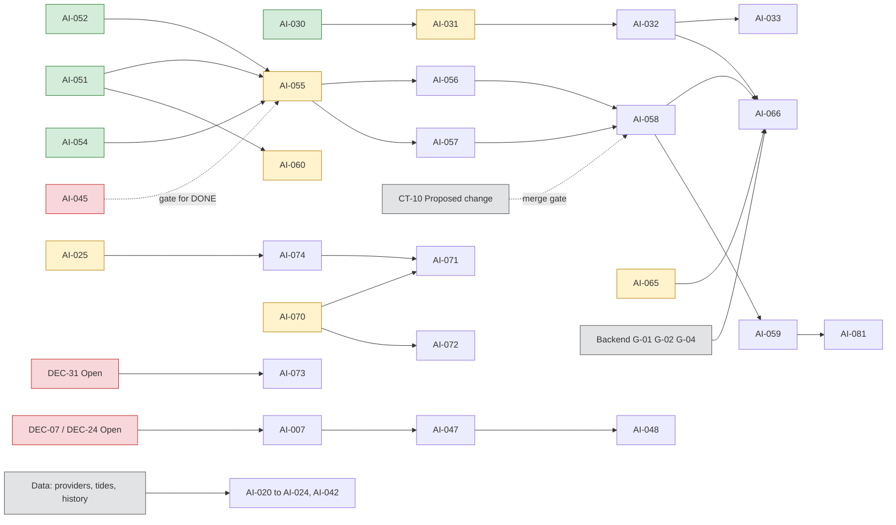

# Autonomous execution plan and checkpoint

Setup record (not in the backlog), written for whoever resumes the AI-track work, human or AI session. The backlog (`ATLANTECH_AI_TASKS.md`) stays the official task list and `WORK_STATUS.md` the tracker; this file holds the execution order, the dependency picture and the resume point. Related: [INTEGRATION_TASKS.md](INTEGRATION_TASKS.md) · [BLOCKED_TASKS.md](BLOCKED_TASKS.md) · [DECISION_RECOMMENDATIONS.md](DECISION_RECOMMENDATIONS.md).

## 0f. Checkpoint 8 (2026-11-22, R12 and the last records)

**Verified with the GitHub pulls API and check runs:** PR #59 (`feature/AI-031-review-followups`, head `cd5e001`) merged as `a5de981` at 12:20:09Z; PR #60 (`feature/SETUP-five-task-post-merge-records`, head `5e95e6b`) merged as `db42b4a` at 12:20:32Z. CI on `db42b4a`: all success. Local `develop` = `db42b4a` (2205 passed, 50 skipped, 1 xfailed). PortHub pointer `0040139` → `db42b4a` (PortHub `2c9fd5c`).

**R12** (corrected `call_sign` longer than `vessels.call_sign` `varchar(10)`): reproduced (MySQL 1406); new ERROR `MALFORMED_CALL_SIGN`. Three separate states:
1. AI Team approval of R12: **given** by the user, 2026-11-22 (AI-031 task decision item (10), Decision row).
2. AI-031 implementation of R12: **IN REVIEW**, `feature/AI-031-call-sign-length` (`d7cd794`, `7cc4a55`), not merged.
3. QA Team's CT-24 code listing: **pending** (INT-Q2).

**Open branches, merge order:** `feature/AI-031-call-sign-length`, then `feature/SETUP-five-task-records-pr60`; then move the PortHub pointer.

## 0e. Checkpoint 7 (2026-11-22, five-task batch post-merge verification)

**Verified with the GitHub pulls API and check runs:**

| PR | Branch | Head | Merge | Merged at (UTC) | CI on merge |
|---|---|---|---|---|---|
| #57 | `feature/AI-031-storable-range-checks` | `3c563b9` | `792cd30` | 2026-11-22 11:54:24 | all success |
| #58 | `feature/SETUP-five-task-batch-records` | `99c882c` | `0040139` | 2026-11-22 11:57:48 | all success |

- PR #45 is the original AI-031 branch (merge `4408065`, 2026-11-21), not the overflow fix.
- **Gap found:** `36b2a8e` (the AI-031 independent-review follow-up: boundary test for every field, stricter MySQL assertion, decision evidence, record) was pushed at 11:54:39, 15 s after PR #57 merged, so it is not in `develop`. Checkpoint 6's "head `36b2a8e`" therefore never reached `develop`. Re-applied by cherry-pick on `feature/AI-031-review-followups` (`c5f99ac`, plus the record correction `cd5e001`). The merged fix code is unaffected.
- No open PRs after the merges.
- Local `develop` fast-forwarded `a604946` → `0040139`; three untracked `reports/` files left byte-identical. On `0040139` (local MySQL 8.4, Redis 7.4): 2196 passed, 50 skipped, 1 xfailed; ruff, format and mypy clean.
- PortHub: `project-ai` pointer `a604946` → `0040139`, commit `2d381d0` on `main` (only the gitlink changed).
- Records: no duplicate tracker rows, decision headings or R entries.

**Statuses:** AI-031 DONE (PR #45; overflow fix PR #57; review follow-up IN REVIEW). AI-032 BLOCKED (R6, INT-B10). AI-051 DONE. AI-055 BLOCKED (AI-045; needs a squat-coefficient source, R3). AI-025 DONE. SETUP-five-task-batch-records DONE (PR #58).

**Next (exact):** merge `feature/AI-031-review-followups`, then this branch; then move the PortHub pointer again to the final `develop` head. Then the user reviews before any new batch.

## 0d. Checkpoint 6 (2026-11-22, five-task batch: AI-031, AI-032, AI-051, AI-055, AI-025)

**Base:** `develop` `a604946` (= `origin/develop`; PRs #55 and #56 merged, so Checkpoint 5's "next 1" is done). No PR open before the batch. Verified with the GitHub pulls API.

**Baseline (local MySQL 8.4 and Redis 7.4 configured like CI):** `uv run pytest -q`: 2192 passed, 50 skipped, 1 xfailed; ruff, ruff format, mypy (156 files) clean.

| Order | Task | Finding | Branch / commit | Status after the batch |
|---|---|---|---|---|
| 1 | AI-031 | Defect: a weight, overhang or stowage value above the `int` maximum passed the rules and failed the AI-032 write (MySQL 1264), so the file never reached quarantine. Fixed. Case 12 re-checked: still no upper bounds anywhere (INT-Q1) | `feature/AI-031-storable-range-checks`, `3c563b9` (CI green, run 45017049377) then `36b2a8e` (independent-review fixes: boundary test for every field, stricter MySQL assertion); pushed; **no PR yet** (PR #45 is the original AI-031 branch, not this fix); not merged | DONE (PR #45); follow-up IN REVIEW, not merged |
| 2 | AI-032 | No AI-owned defect. Criterion 3 stays the Backend's (CT-12 step 5, DEC-08); Backend `develop` `554b09c` has no step-5 handler or test | none | BLOCKED (R6, INT-B10) |
| 3 | AI-051 | No defect; criteria, FIFO re-check and loader integration verified | none | DONE |
| 4 | AI-055 | No defect; DEC-32 holds use per-job intervals (AI-050 #56); new assignments keep the rule-4 interim (no job durations); `pilot_requested` still missing (INT-B9) | none | BLOCKED (AI-045, R3) |
| 5 | AI-025 | No defect; 48 h boundary tested; AI-053 has an equivalent inline age check (follow-up for AI-053) | none | DONE |

**Records branch:** `feature/SETUP-five-task-batch-records` (this file, the four records, the trackers, the report `reports/AI_FIVE_TASKS_EXECUTION_REPORT.md`, and two stale records: SETUP-round3-merge-records → DONE, AI-050 → PR #56).

**Next (exact):**
1. Open and merge the PR for `feature/AI-031-storable-range-checks` (head `36b2a8e`), then the PR for `feature/SETUP-five-task-batch-records`. After the AI-031 merge, record its PR number and merge SHA on the records branch before merging it (keep both sides of any `WORK_STATUS.md` conflict; the AI-031 row is changed only on the AI-031 branch).
2. Move the PortHub `project-ai` pointer to the new `develop` head.
3. Decisions R3 (unblocks AI-045 → AI-055 close) and R6 plus INT-B10 (closes AI-032); INT-Q1 (AI-031 case 12).

## 0c. Checkpoint 5 (2026-11-22, full audit)

All 76 backlog tasks are classified in `reports/AUTONOMOUS_EXECUTION_FINAL.md` § Round 5:
- 30 DONE;
- 1 merged and awaiting decision approval;
- 7 blocked on a decision;
- 6 blocked externally;
- 1 deferred;
- 31 waiting on unfinished prerequisites;
- 0 READY.

**Overlooked item, now done:** the DEC-28 and DEC-32 schema follow-ups, on `feature/AI-050-dec28-dec32-schema-followups` (`6e9f23e`).

**Handoff:** R1–R11 and the external requests are in `DECISION_RECOMMENDATIONS.md` § Handoff.

**Next:**
1. Merge this branch and the AI-050 follow-up branch.
2. Move the PortHub pointer.
3. Act on whichever decision lands first.

## 0b. Checkpoint 4 (2026-11-22, after the round-3 merges)

**Verified on GitHub (pulls API and check runs):** PRs #48 (AI-065, `7fc6954`), #49 (AI-056, `44fd4ec`), #50 (AI-074, `8b2032c`), #51 (AI-032, `44e4b95`), #53 (AI-060 handler, `7042ceb`), #52 (AI-072, `b98024a`) and #54 (SETUP-post-merge-records, `ddfb551`) merged into `develop` on 2026-11-22. CI on `ddfb551`: `ci-ok`, `tests`, `lint`, `typecheck`, `secret-scan` all success. The SETUP merge kept every tracker row, so stale duplicates came back; `feature/SETUP-round3-merge-records` removes them.

**Statuses (by acceptance criteria):** DONE: AI-056, AI-074, AI-060, AI-072, SETUP-post-merge-records. AI-065 stays IN REVIEW (Proposed mapping). AI-032 BLOCKED on criterion 3 (R6, INT-B10). AI-033 DEFERRED (DEC-17).

**Nothing is both eligible and buildable now:**
- AI-071 needs metric definitions (R9).
- AI-058 needs AI-057, which needs templates (INT-Q4).
- AI-066 needs AI-058.
- AI-073 needs DEC-31 (R2).
- AI-045 needs R3.
- AI-007 needs R4.
- AI-020 to AI-024 and AI-042 need data.

**Exact next action:**
1. Merge `feature/SETUP-round3-merge-records`.
2. Decide R2, R3, R4, R6, R7, R8 and R9.
3. Deliver INT-Q4, INT-B1 and INT-B10.

The first of these that lands unblocks: R9 → AI-071; R2 → AI-073; R3 → AI-045; R4 → AI-007; INT-Q4 → AI-057 → AI-058.

## 0a. Checkpoint 3 (2026-11-21, round 3)

See `reports/AUTONOMOUS_EXECUTION_FINAL.md` § Round 3: the PR queue (six task branches, SETUP last), the new AI-060 handler branch (`4add5e0`), the AI-057 finding (no templates, INT-Q4) and the exact next action. Decision review R6–R8: `DECISION_RECOMMENDATIONS.md`.

## 0. Checkpoint 2 (2026-11-21, after the first merge round)

**Verified on GitHub:** PRs #41 to #47 merged into `develop` on 2026-11-21 (SETUP `6ed8c91`, AI-070 `78c1590`, AI-025 `1a996e0`, AI-092 `fec76df`, AI-031 `4408065`, AI-055 `c7e60f1`, AI-060 `8b955ed`); CI (`ci-ok`: lint, typecheck, tests with MySQL and Redis, secret scan) green on every merge commit. `develop` = `8b955ed`: 1634 unit tests pass locally (1433 + 201). **AI-065 was not merged** (no PR was opened); its branch now has `develop` merged in and conflicts resolved (head `62f3af0`, CI green). The merge round re-added the stale AI-051 tracker row; this branch removes it.

**PortHub:** `38dd6b5` and `a3a1eb3` are on `main`; pointer moved again in `e06e102` (`project-ai` → `8b955ed`). Shared Decisions still identical up to "AI task decisions"; Contracts unchanged.

**Task states after verification:** DONE: AI-025, AI-031, AI-092, SETUP-autonomous-execution-records. BLOCKED after merge: AI-055 (AI-045 gate), AI-070 (registration, DEC-08 grants). IN PROGRESS: AI-060 (queue handler).

**Second round, pushed and awaiting PR + merge:**

| Task | Branch | Head | Note |
|---|---|---|---|
| AI-065 | `feature/AI-065-yard-placement-design` | `62f3af0` | Carried over; `develop` merged in |
| AI-056 | `feature/AI-056-solver-outcome-handling` | `ac3f51a` | 19 tests, CI green |
| AI-074 | `feature/AI-074-trusted-data-selection` | `57b3817` | 8 unit + 1 integration test |
| SETUP | `feature/SETUP-post-merge-records` | see branch | These records. **Merge it last** |
| AI-032 | `feature/AI-032-baplie-commit-quarantine` | `6ae3ce7` | 35 unit + 2 MySQL tests (fault injection); full suite with services passes locally |
| AI-072 | `feature/AI-072-drift-monitor` | `f3483fb` | 15 unit + 1 MySQL test; thresholds DEFERRED (DEC-30 TR-01/02) |

**Placement rule (fewer conflicts):** new task-decision entries and tracker rows are inserted right after their predecessor's (AI-056 after AI-055, AI-074 after AI-025), not at the end. AI-065, AI-056 and AI-074 touch different places and merge in any order. The SETUP branch edits the rows next to those inserts, so merge it last; its conflicts are resolved on the branch by merging `develop` into it.

**Merge check:** `git merge-tree` shows AI-065, AI-056, AI-074, AI-032 and AI-072 merge cleanly with each other; only this SETUP branch conflicts (tracker rows).

**Still ready after that, not started:** the shared DB loader for B2's `FilterContext` (unblocks the AI-060 handler and AI-058); AI-057's engine, without real templates (AI-009).

**Exact next action:** open PRs for the branches above (SETUP last), then recompute: AI-058 needs AI-056, AI-057 and the CT-10 approval; AI-033 and AI-066 need AI-032; AI-071 needs AI-074.

## 1. Checkpoint 1 (2026-11-21, history)

| Item | State |
|---|---|
| Authorization | The user's standing execution authorization of 2026-11-21 (plan approval and `APPLY CHANGES` for eligible tasks; no protected-branch pushes, no local merges) |
| `origin/develop` | `3180e90` (PR #40). Every branch below starts there |
| PortHub `origin/main` | `a3a1eb3`: `38dd6b5` synced DEC-34 Closed and the AI-051 CT-10 Proposed row; `a3a1eb3` points `project-ai` at `3180e90`. Decisions identical up to "AI task decisions" |
| Tools | `gh` not installed: no PR can be opened or merged from this machine. `git push` works. Docker daemon down: integration tests run only in CI |
| Baseline tests at `3180e90` | 1433 passed, 47 skipped, 454 integration deselected; ruff, format, mypy clean |
| Pre-session work | Backed up with hashes in `C:\Users\Dev-Mustafa\ATLANTECH\_backups\2026-11-21-preflight\`; the AI-065 record moved onto its fast-forwarded branch |

**Pushed, awaiting PR and merge** (no task here is `DONE` until its PR is merged):

| Task | Branch | Head | Tests added | Note |
|---|---|---|---|---|
| AI-065 | `feature/AI-065-yard-placement-design` | `5884fad` | — (decision task) | B8 constraint-to-table mapping |
| AI-055 | `feature/AI-055-b5-cp-sat-allocation-model` | `86ea7d6` | 51 | Adds `ortools`. Not `DONE` before AI-045 |
| AI-031 | `feature/AI-031-baplie-validation-rules` | `23d0148` | 70 (+1 skip) | Corpus case 12 skipped (no stowage bounds) |
| AI-060 | `feature/AI-060-override-validation-service` | `4b12897` | 27 | Queue handler wiring is a follow-up |
| AI-025 | `feature/AI-025-data-quality-checks` | `6488341` | 21 | |
| AI-070 | `feature/AI-070-model-registry-integration` | `36fdd09` | 16 (+2 integration) | Registration blocked by DEC-08 grants |
| AI-092 | `feature/AI-092-observability-logs-metrics` | `71ce70c` | 16 | Touches `common/runtime/worker.py` |
| SETUP | `feature/SETUP-autonomous-execution-records` | this branch | — | These records; DEC-34 and AI-051 marked `DONE` |

**Merge note.** Every task branch appends one entry to the end of `docs/ref/ATLANTECH_Decisions.md` and one row to the end of `docs/tasks/WORK_STATUS.md`. After the first merge, each later PR shows a conflict there; resolve by keeping both sides. Suggested order (fewest code overlaps first): AI-065 → AI-025 → AI-031 → AI-070 → AI-092 → AI-055 → AI-060 → SETUP. After each merge, move the PortHub `project-ai` pointer to the new `develop` head.

**Exact next action.** Open the eight PRs into `develop` (links in `reports/AUTONOMOUS_EXECUTION_FINAL.md` §11), get CI green and merge. Then recompute the ready set: AI-032 (after AI-031), AI-056 and AI-057 (after AI-055), AI-074 (after AI-025), AI-071 and AI-072 (after AI-070 and their other prerequisites).

## 2. Task inventory (state on 2026-11-21)

| State | Tasks |
|---|---|
| DONE (merged into `develop`) | AI-001 to AI-006, AI-008 to AI-016, AI-023, AI-030, AI-044, AI-050 to AI-054; DEC-20, DEC-21, DEC-34; SETUP-001 to SETUP-003 |
| AWAITING MERGE (this session) | AI-025, AI-031, AI-055, AI-060, AI-065, AI-070, AI-092 |
| NEEDS USER DECISION (AI Team owns it) | AI-073 (DEC-31), AI-007 (DEC-07, DEC-24), AI-045 path (synthetic data, see recommendations) |
| BLOCKED_INTERNAL (waits for a merge) | AI-032, AI-056, AI-057, AI-074, AI-071, AI-072, AI-058 and everything after them |
| BLOCKED_EXTERNAL (data or another team) | AI-020, AI-021, AI-022, AI-024, AI-042, AI-100 to AI-106 (flag D); AI-066 also needs Backend G-01/G-02/G-04 |
| NOT STARTED, later waves | AI-033, AI-040, AI-041, AI-043, AI-046 to AI-049, AI-059, AI-061, AI-062, AI-067, AI-068, AI-080 to AI-084, AI-090, AI-091, AI-093 to AI-095 |

Details per blocked task: [BLOCKED_TASKS.md](BLOCKED_TASKS.md).

## 3. Dependency picture (open work)

**Critical path now:** merge AI-055 → AI-056 / AI-057 → AI-058 (also needs the CT-10 approval) → AI-059 → AI-081 → AI-090. AI-045 (needs a decision on synthetic data, or AI-043 first) gates marking AI-055 `DONE` and any Part 2 demo.

**Independent streams after the merges:** EDI (AI-032, AI-033) · Part 2 outcomes (AI-056, AI-057) · Part 3 (AI-074, then AI-071, AI-072) · Part 1 (after DEC-07 / DEC-24 and the data tasks).

## 4. How to resume

1. Read this checkpoint, then `git fetch` and check which of the branches in §1 are merged (`git branch -r --merged origin/develop`).
2. For each merged task, set its `WORK_STATUS.md` row and status record to `DONE` and move the PortHub pointer.
3. Recompute the ready set with the backlog's §3.2 table and §2 here; start each new task from the fresh `origin/develop`.
4. Check [DECISION_RECOMMENDATIONS.md](DECISION_RECOMMENDATIONS.md) for answers the user has given since.
